# 视觉表达学习资料：图文阅读版

建议先打开[离线资料馆](index.html)，获得图与分析并排、多轴筛选、手法专题与练习。

分类、表达解读、应用场景和练习是教学建议，不能当作原作者意图。原研究是间隔概览与局部连续帧，不声称连续看完100部；音画对拍未核验。H30详细制作方式仍待核，16条局部参考不能写成100部全片精品认证。

## 九种视觉类型

### 信息成为叙事

先让观众理解规则，再让规则发生变化。面板、坐标、进度和弹窗可以承担叙事，但必须区分主信息与环境纹理。

应用：产品功能解释、推理线索、人物关系、搜索与等待、制度压力、人与机器的关系。

练习：用同一句“正在寻找一个人”做三种状态：有秩序的搜索、遇阻、失控。每版只允许一个主信息区和两层辅助信息。

### 字体就是画面

文字不只传递句义；尺寸、密度、位置和停留也能表现权力、迟疑、压迫或爆发。先确定读什么，再设计怎样读。

应用：片头、宣言、观点短片、情绪段落、纯文字预告、预算有限但有明确文案的作品。

练习：选一段自己写的40字文案，制作“克制”和“急迫”两版；不增加文字，用停留、字重和留白改变语气。

### 人物与图形对话

图形应围绕人物轮廓、视线和动作分配重量。综合色彩与形状，比随意增加元素更能建立风格。

应用：角色介绍、青春与活力、音乐视觉、活动包装、虚实人物合成、鲜明的个人品牌。

练习：同一人物只配两种主色、三种形状做三张版式。分别让形状承担“包围、引导、遮挡”一种功能。

### 让静止画产生空间

空间感来自前后遮挡、尺度差、景深和运动差。轻微视差只应放大画面已有关系，不能让静止人物像纸片随意漂浮。

应用：漫画改编、人物回忆、纪念、故事提案、海报动态化、低动作但高情绪密度的段落。

练习：一张有权使用的图片分三层，制作6秒镜头：先只推拉，再加视差，最后加一层前景；比较情绪是否更明确。

### 动作与冲突的组织

强度依赖准备、接触和结果的关系。镜头快慢、景别和方向共同决定是否看得清；冲击帧只是强调，不能替代动作因果。

应用：战斗、运动、竞速、预告、产品性能演示、情绪冲突的高潮。

练习：用三个动作片段组成8秒“准备—碰撞—结果”，先不用特效；再仅加一次光效和一次短停顿，检验是否更清楚。

### 人物关系与叙事

先确定观众知道什么、角色知道什么，再安排细节和反应。叙事不需要始终复杂的特效，关系变化本身可以成为画面变化的理由。

应用：人物短片、剧情提案、广告小故事、关系重组、讽刺、科幻伦理、生活反转。

练习：写一句人物欲望，再用“道具—动作—反应”三镜讲清一次转折。静音播放仍要看出信息变化，音频另行制作与核验。

### 营造世界与尺度

大场面需要尺度参照与层次。小人物、门窗、雾层、近景遮挡和慢镜头共同让观众体会环境，而不是只把所有东西放大。

应用：世界观设定、建筑概念、游戏场景、旅行氛围、神圣感、孤独感或压迫感。

练习：同一环境做“敬畏”和“孤独”两版，不换主体，仅改变人物比例、负空间、镜头停留和前景遮挡。

### 用素材建立新联系

素材的意义取决于相邻镜头。动作、视线、颜色、形状与主题都能成为连接线；优质摄影是输入，选材关系才是剪辑者的增量。

应用：纪念混剪、品牌回顾、旅行、纪录短片、情绪随笔、多来源素材的主题表达。

练习：用六个不同来源的画面分别按“同动作、同颜色、同主题”排三版，写下每版新增的含义，而不只说顺滑。

### 把抽象变得可见

变化规则应让观众看见关系：保持一个不变量，再改变一个量。图形越精密，越要区分视觉隐喻与事实解释。

应用：抽象概念、数据叙事、科学传播、音乐空间、机制演示与程序艺术。

练习：用一个自己核实过的简单关系做10秒解释：先给对象、再演示单一变化、最后显示结论。记录哪一层只是装饰。

## 100个案例

本阅读版每例精选最多3个分析单元；每例全部图文分析、摘录和手法应用请打开对应的完整案例页。

### AI01 〖4K〗如果聊天窗口就是她的整个世界 —— world.execute(me)

类型：信息成为叙事；题材：程序与虚拟关系；用途：主要视觉研究样本。

把“程序执行”读成关系变化：主面板、大标题和角色之间如何交换注意力？红黑高潮与冷色界面怎样形成情绪分段？

**8—24秒 · 终端输入／光标／字符网格**

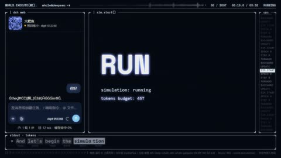

深色界面中以终端与字符信息组织画面，主信息与环境日志具有不同层级。

复现建议：定时截取字符串，光标单独显隐；网格字符按遮罩绘制。

**40—42秒 · 参数曲线／切线与移动标记**

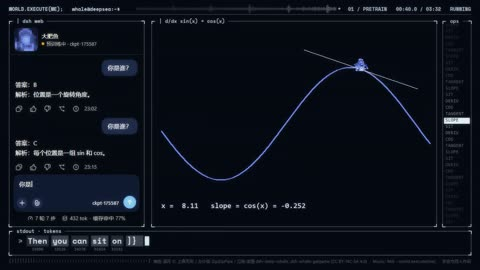

曲线、切线和标记点在坐标空间建立关系；这是图形内部变化。

复现建议：参数化曲线采样，切线与标签绑定运动点。

**80—82秒 · 计数器／粒子拆散／面板重排**

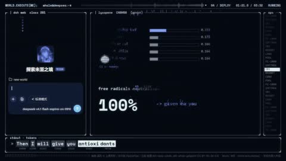

百分数变化、连线散成点和版式重排分层发生，不能把每个数字变化算换镜。

复现建议：数字插值、点线显隐与布局状态机分别控制。

[完整图文案例](cases/AI01.html) · [原始观察](../REPORT.md)

### AI02 〖4K60〗用10亿token 13017帧 画出Claude眼中的世界 | world.execute(me);

类型：信息成为叙事；题材：程序与虚拟关系；用途：主要视觉研究样本。

橙黑米白、花形标志、人物剪影和圆角界面贯穿；数学说明、人物和错误窗口有疏密变化。

**0—66秒 · 终端打字机、界面骨架揭示、环形路径排字、数学图形动画**

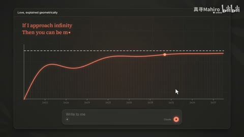

深色聊天界面从线框和占位条转到聊天框，英文标题、歌词和代码逐段显示；36–48秒有点集、环形字、函数图表。

复现建议：Canvas/SVG绘制UI，文字substring或矩形遮罩揭示，按t更新点线坐标；沿圆弧逐字布局

**54—126秒 · 像素化降采样、半色调网点/点阵化**

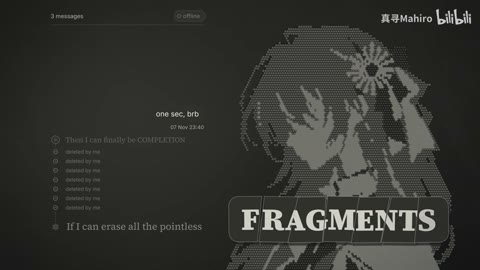

54秒出现低分辨率马赛克；126秒人物呈离散点阵/网点印刷轮廓。

复现建议：先缩小再nearest放大；按亮度阈值或有序抖动绘制圆点/像素

**138—162秒 · 故障弹窗轰炸、界面拼贴、代码逐行执行、计数器**

错误提示和聊天窗口层层叠放，粉红色ILLEGAL ARGUMENTS与EXECUTION反复出现；随后代码行高亮与run计数变化。

复现建议：独立卡片图层按时间出现/位移；确定性排布，代码高亮区横向遮罩，计数floor(time*rate)

[完整图文案例](cases/AI02.html) · [原始观察](../evidence/BV186pc65E68/REVIEW.md)

### AI03 GPT6-Astra眼中的world.execute(me)

类型：信息成为叙事；题材：程序与虚拟关系；用途：主要视觉研究样本。

固定圆角终端与琥珀字符统一，后段粉红大字/角色提供局部高潮；视觉变化主要靠字符排列而非新人物美术。

**8—24秒 · 字符画／点阵标题**

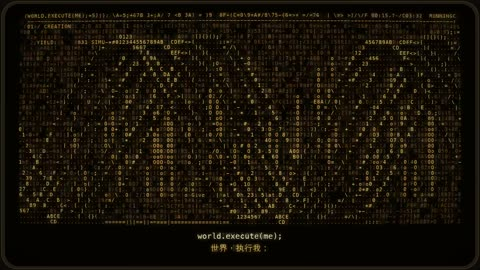

字符格点与大型点阵标题组织画面，文字同时具有信息和材质两种用途。

复现建议：字形遮罩采样，依灰度或形状放置字符。

**40—56秒 · 字符曲线／环形结构**

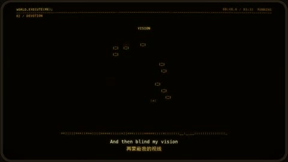

字符组成曲线和环形空间，重复规则提供秩序。

复现建议：沿参数曲线放字符，控制相位、尺度与透视。

**72—74秒 · 有限递归终端框**

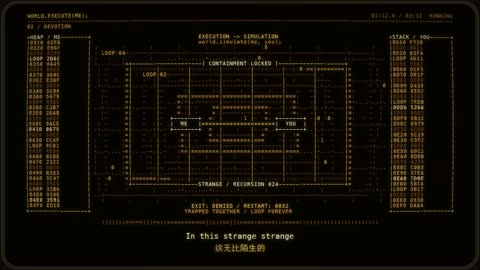

内嵌框、日志和中心主体形成向内的空间层次。

复现建议：有限层复制，缩放、偏移和透明度分层控制。

[完整图文案例](cases/AI03.html) · [原始观察](../REPORT.md)

### AI04 〖4K〗如果到处都是她的名字，你还能找到她吗 —— world.search(you)

类型：信息成为叙事；题材：程序与虚拟关系；用途：主要视觉研究样本。

搜索不是只画一个输入框。观察名字、空间和界面如何把“寻找”变成持续的观看任务。

**0—40秒 · 聊天窗展开／光标逐字输入／排序气泡图**

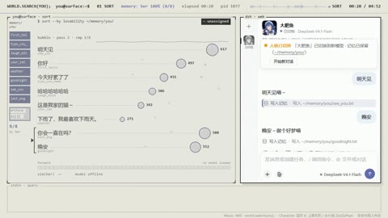

黑底小输入框转浅色聊天界面，左侧消息被排成气泡行，右侧对话保持统一界面。

复现建议：按时间线绘制窗口、光标、文字和气泡；对话内容与图表数据由脚本提供。

**45—105秒 · 代码表格排版／像素图标／局部数字与条形更新**

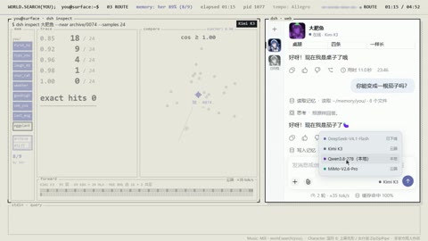

左侧代码和表格与右侧聊天对应，椅子、猫、牛排等像素图标出现，透视线网与数值替换。

复现建议：矢量网格、文本逐字揭示、像素精灵和图表数值插值。

**130—150秒 · 图片比较网格／扭蛋机示意／重复窗口**

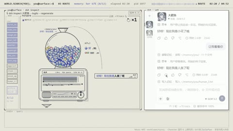

角色图像嵌入网格比较，随后扭蛋机内彩球与计数、底部对话小窗逐项增加。

复现建议：图像裁切、比较网格、圆粒子容器与计数、窗口复制。

[完整图文案例](cases/AI04.html) · [原始观察](../evidence/BV18YHf63EyC/REVIEW.md)

### AI05 〖GPT×Codex二创PV〗如果聊天窗口就是她的整个世界 —— Wrap Me In Plastic

类型：信息成为叙事；题材：程序与虚拟关系；用途：局部机制／局限参考。

全片固定灰白终端骨架、角色对话与右侧图表，后部转红形成情绪分段；统一性强，但整体布局变化少于主参考的全屏字卡/人物大构图。

**0—28秒 · 深色终端界面／模块分区／加载格与折线图**

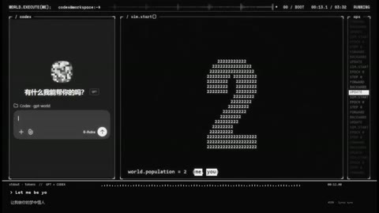

概览0秒黑场下方细信息条，4秒权重格/进度条，8秒配置小字，12秒字符人形，20秒下降折线，24秒训练流水线格。它们是同一界面框架内的可视化模块。

复现建议：Canvas/SVG绘边框、等宽文本、网格与折线，各模块按时间开关；图表数据驱动插值。界面参数是叙事道具，不等于真实训练监控。

**28—60秒 · 点云轮廓／正弦曲线／因果矩阵／多窗口肖像**

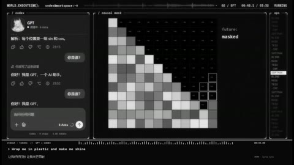

28秒点集形似人物，32秒圆周虚线、36秒正弦曲线，44秒下三角矩阵，48秒计数/柱图，56秒九宫格点云人物。

复现建议：人物遮罩内按密度取点，点坐标沿目标插值；曲线按函数绘制，矩阵按索引着色，多窗口复用同一图层。

**68—100秒 · 像素生成图／热图／波形与角色姿势槽位**

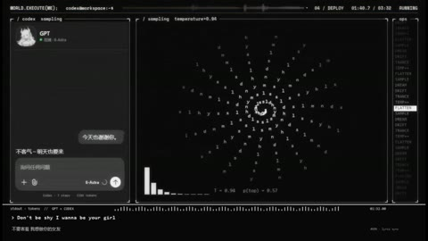

68秒分类条图，72秒灰白像素果实，76秒热图，92秒字符旋涡，96秒脉冲与格子，100秒白龙娘静态姿势。抽样不足以核实12姿势全部使用方式。

复现建议：低分辨率离屏画布最近邻放大，热图矩阵映射灰度；角色PNG/图集按姿势槽位切换，少量旋转缩放和网格变形。

[完整图文案例](cases/AI05.html) · [原始观察](../evidence/BV19aaB62EJv/REVIEW.md)

### AI06 〖DS曲绘〗甩下踌躇吧，因为朝阳是你也是我——东方红的心脏

类型：信息成为叙事；题材：二次元角色／音乐视觉；用途：局部机制／局限参考。

这是重要的改错案例：中央关键词明确，边缘细字过暗。学习统一系统语言，也要识别暗色美术牺牲了哪些信息。

**0—108秒 · 琥珀终端界面／细线面板／低亮度 HUD**

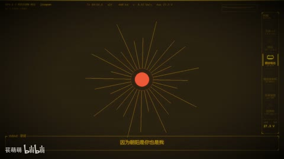

整体黑底黄字，左侧经纬线球、右侧图形、最右状态条与底部小字；大多信息较小、低对比，风格统一但可读性需更大屏检查。

复现建议：统一调色板与网格，细线画框，等宽字，小数值定时更新，独立分区用裁切蒙版。

**6—90秒 · 阶梯波形／椭圆轨道／线框球旋转**

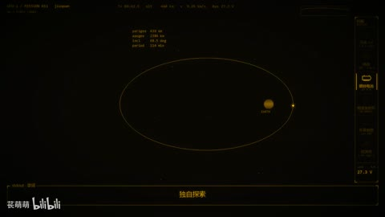

6秒阶梯线、12秒轨道、42秒单轨道，90秒球与轨道并置。运动模块反复使用而非每段全新场景。

复现建议：正交线段插值、椭圆参数运动；经纬线球3D投影后画线，按时间改角度与数值。

**30—78.6秒 · 随机亮块／棋盘置换／中心红圆与辐射线**

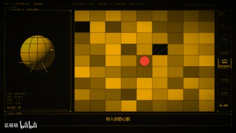

76.625–78.458右窗黄黑方块逐格亮灭，中心红点位置变化；78.542只剩较小中央光块与线框物体，左球和外框保留。

复现建议：规则网格按伪随机种子/音量控制alpha，中心圆与径向线单独层；按缩放与淡出转下一图形。

[完整图文案例](cases/AI06.html) · [原始观察](../evidence/BV1s5YA6KEiF/REVIEW.md)

### AI07 〖开源“手书”〗洛琪希的魔术之心/トリックハート

类型：人物与图形对话；题材：二次元角色／音乐视觉；用途：主要视觉研究样本。

红/米白/蓝统一，特写、双人全身、沙发、斜小窗和前景鸟形有尺度变化，手绘边缘保持整体风格。

**4—12秒 · 手绘纸框／人物差分／竖排条签**

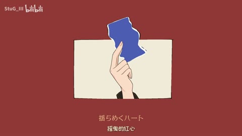

红底米色不规则画框内人物表情和手部道具变化，随后两个人物全身像与竖排字条同框。

复现建议：透明人物差分、纸边蒙版、文本逐段显隐，主体按预设镜头表摆放。

**20—36秒 · 漂浮硬币／鸟形剪影／横向画框／眼内符号**

金币浮在大字上方，米色鸟形从人物附近扩散，横条框裁人物脸，眼部出现星号样装饰。

复现建议：道具路径与旋转、鸟形粒子、矩形遮罩、眼部跟随小图形。

**43.5—45.5秒 · 道具替换／白烟遮挡／兔子放大过镜**

44.167秒附近持牌手变空手，44.417秒白烟包围手，44.75秒胡萝卜出现，45秒兔子进入，45.333秒兔子被大幅放大遮住画面。

复现建议：手势差分与道具图层分开，在烟团遮挡时替换道具，兔子图层缩放越过镜头。

[完整图文案例](cases/AI07.html) · [原始观察](../evidence/BV1c2an65EVj/REVIEW.md)

### AI08 〖4K60〗饭卡《OverThink》MV by Opus5.5

类型：信息成为叙事；题材：程序与虚拟关系；用途：主要视觉研究样本。

红黑米白贯穿递归框、酒杯、胶片字阵、叶片标本和机械字筒；每场主体不同但视觉语汇统一，有留白和明暗段落。

**4—24秒 · 递归圆角框／时间波形／线框酒杯／星场排字**

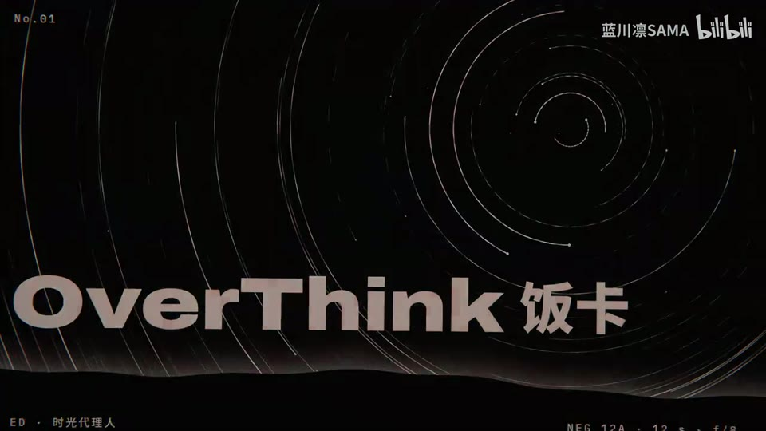

红黑空间圆角矩形层层错开，秒表与波形同框，弯曲星场网格和线框酒杯配竖字。

复现建议：矩形副本偏移、程序波形与数字时钟、参数化酒杯网格和粒子球面、路径文字。

**28—48秒 · 胶片条字阵／圆形放大镜／线描植物标本／档案卡**

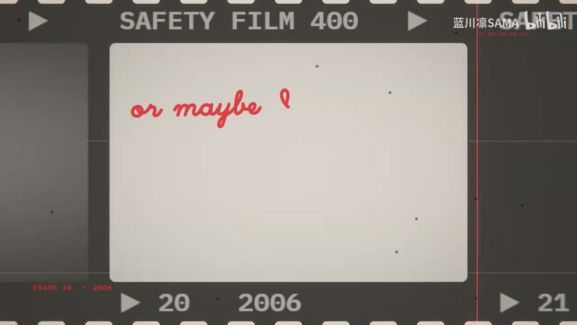

汉字逐格排入胶片条，圆镜放大局部；叶片以密线条构成，背景为标本标签和纸卡。

复现建议：胶片贴图、逐格文本、放大区域圆形蒙版、贝塞尔叶脉和档案卡排版。

**50.1—52.1秒 · 逐字红色高亮／曝光脉冲／卡片切圆柱字筒**

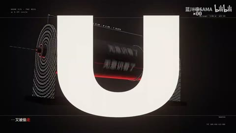

同一档案卡上文本逐字增加并依次变红，画面亮暗波动；51.833秒切到黑底圆柱，52.033秒大号字母进入前景。

复现建议：逐字时间表、红黑填充切换、轻微曝光变化，切至圆柱文字贴图的空间镜头。

[完整图文案例](cases/AI08.html) · [原始观察](../evidence/BV1cdaf6QEad/REVIEW.md)

### AI09 〖GPT-6Astra“手”书〗Time is mine (A-SOUL.ver)

类型：人物与图形对话；题材：二次元角色／音乐视觉；用途：主要视觉研究样本。

亮黄巨字与暗段手电形成强对比；区分角色姿态、文字版式和多语字幕各自的任务，避免信息同时争夺注意。

**4—12秒 · 巨型英文重复字／手电锥形遮罩／人物亮暗切换**

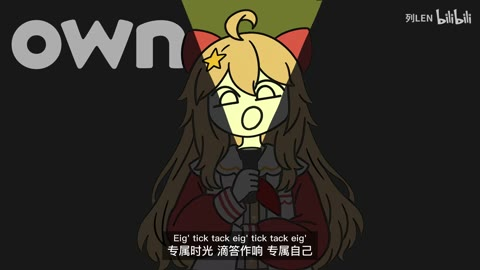

暗底人物前后是大号浅字；手电对应黄色三角光区，人物脸与身体受遮罩局部照亮。

复现建议：人物暗版与亮版叠层，以手电发出的三角形遮罩揭示亮版；大字作背景层。

**16—40秒 · 倾斜梯形画框／环境切换／表情差分**

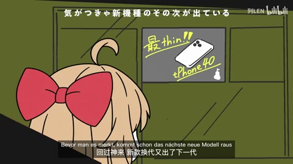

人物睡姿、碗筷、广告牌和相框场景依次放入斜边窗口；角色小人和表情替换。

复现建议：不规则多边形遮罩、场景图替换、人物差分和位置缩放。

**43.6—45.6秒 · 大字冲屏／拳头前景／白色放射形转场**

44.125秒左右大黑字进入人物前景，44.292秒换亮黄背景并由拳头和白色放射形占画面，44.625秒转黄底人物与背景大字。

复现建议：文字平移缩放、拳头PNG前景、白色爆炸形状遮罩，遮满时替换画面。

[完整图文案例](cases/AI09.html) · [原始观察](../evidence/BV182hm6NEZy/REVIEW.md)

### AI10 伟大前程，自己挣！〖AI全民制作人〗

类型：人物关系与叙事；题材：历史／生活寓言；用途：主要视觉研究样本。

书桌暖光、水房冷灰、电话近景与父子暖色同框区分情境；近景表情与学习/走廊场景交替，最后照片履历卡单列。

**0—68秒 · 双层叙事字幕、括号式旁白、底部对白字幕**

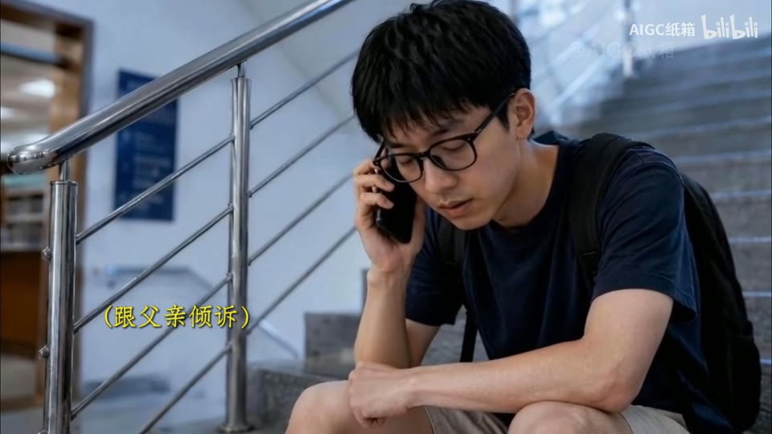

白色底部对白字幕与黄色括号旁注并存；黄字落在画面侧下方，解释人物心理与剧情进程，文字大体保持静态可读。

复现建议：准备对白/旁白时间轴，用ASS字幕或Canvas分层渲染，设置固定安全区、阴影/细描边

**0.2—2.133秒 · 第一人称快速摇镜、荷兰角、动作牵引镜头、局部亮闪**

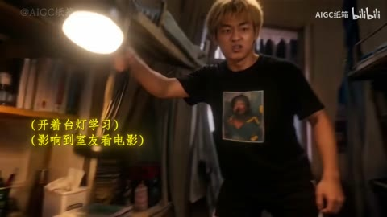

从桌面第一人称书本视角快速向右上方看向室友，镜头倾斜，随后手持台灯的动作向地面落下，画面短暂高亮；主体空间连续。

复现建议：已有视频可裁切/旋转/运动模糊与曝光关键帧；如果要生成手臂、台灯和人物连贯运动，需要视频模型或实拍，不能仅靠简单2D特效

**9—10.933秒 · 叙事硬切、同场景动作省略剪辑、景别切换**

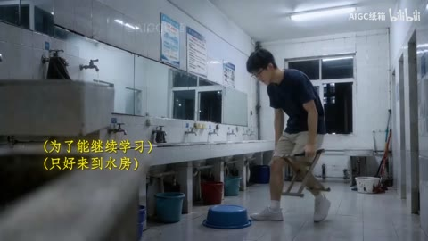

9.333→9.400秒由走廊背影硬切到水房迎面走来；10.400→10.467秒从走近的全景跳到坐下的较近构图，人物、衣服、空间保持主要对应。

复现建议：按动作段落裁切拼接，匹配主体位置与方向，字幕跨镜保持；关键在筛出连续素材

[完整图文案例](cases/AI10.html) · [原始观察](../evidence/BV1A3Ts6tEVr/REVIEW.md)

### AI11 原创AIGC剧集《有异人》〖AI全民制作人〗

类型：动作与冲突的组织；题材：东方奇幻／怪诞；用途：主要视觉研究样本。

旧面馆、异星城市、湿地夜景、暖光骑乘和室内地图形成不同空间段落，广角群像与反应近景提供视觉层级。

**0—66秒 · 写实异星角色／浅景深正反打／固定对白字幕**

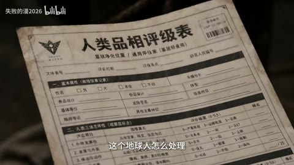

面馆中人类、蟹状外星角色、盔甲执法者的中近景和特写交替，背景普遍较虚；白色小字号对白字幕在下方居中。60秒概览另有纸质评级表插入镜头。

复现建议：先准备各角色与场景一致的镜头，按对白组织正反打；字幕用定时文字层与轻描边/阴影；景深可在源镜头制作，或用人物遮罩加背景模糊模拟。

**72—90秒 · 科幻城市建立镜头／新旧建筑尺度对比**

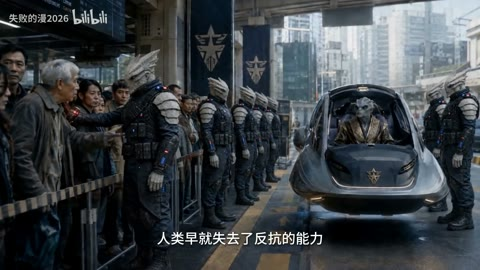

72秒是老建筑与高耸发光塔、飞行器同画面；78秒外星角色近景，84秒队列与车，90秒老人近景。高塔和飞行器是场景内容，不能仅凭外观确定3D软件。

复现建议：先构建或生成城市总览，再用不同角色与景别说明世界；霓虹辉光可分层叠加，真实遮挡和透视需要镜头级制作。

**109.6—111.6秒 · 景别递进硬切／低机位踢击／倾斜动作镜头**

109.6秒是店员与蟹角色同框，110.0秒变店员近景，110.267秒变蟹角色低角度近景，110.867秒换鞋和腿近前景的低机位；111.2秒起店员倒地、商品散落。后半段快速视角移动和物件飞散应与硬切分开统计。

复现建议：分镜预先列同框、反应、威胁特写、出脚和受击；已有素材用帧准确硬切。动作生成需检查肢体接触、空间方向与物件连续性；轻微倾斜和运动模糊可在剪辑层补。

[完整图文案例](cases/AI11.html) · [原始观察](../evidence/BV1psN86KEt5/REVIEW.md)

### AI12 猜猜这是哪个AI做的，Opus 5.5还是Deepseek 1017？

类型：把抽象变得可见；题材：数学／抽象程序艺术；用途：主要视觉研究样本。

比较线束、棱镜、空间线框和图表的层次；把规则几何的变化与镜头替换区分，理解“参数在动”与“观点改变”的差别。

**0—2秒 · 打字机／输入光标**

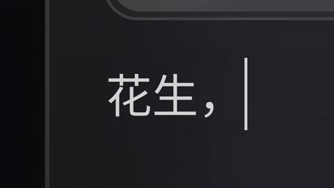

输入框的“花生，你会做什么”逐字增加，竖线光标跟随；框体视图缓慢改变

复现建议：“打字机／输入光标／界面缩放”。文字截取、光标位置和相机裁切都容易代码直出。

**12—16秒 · 径向线束／线框图形空间变换**

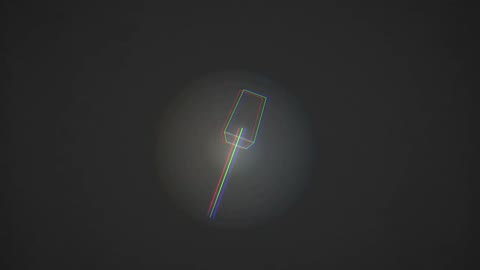

大量细线向中心汇聚，紫色短条分布其间，中心小物体逐渐变大，外围线条退去

复现建议：“星际隧道／径向线束／速度线”。2D极坐标线段与透明度可做基础版；有真实空间变化时用Three.js相机与线段。

**16—20秒 · 棱镜分光／光束辉光**

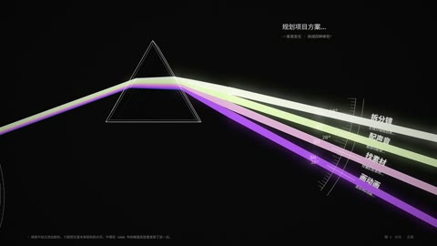

单束光经过三角形后分成紫、粉、黄、白等多条光束，旁边标功能名称

复现建议：“棱镜分光／加法辉光／标签引线”。曲线或线段多层模糊加法叠加，配合几何图形可做基础版；未核验其真实物理光学。

[完整图文案例](cases/AI12.html) · [原始观察](../evidence/BV14ZJR6DEXN/REVIEW.md)

### AI13 原创AI短片《大傩》｜第7回 梦落铡声，诡异来袭

类型：动作与冲突的组织；题材：东方奇幻／怪诞；用途：主要视觉研究样本。

前段日照庭院的喜剧反应与后段冷暖室内、绿焰幻象区分，眼镜绿火、面具和手中道具特写可作为局部效果例。

**0—15秒 · 旧纸道具特写／浅景深／逆光悬浮书**

开头旧纸书页近前景与模糊人物，5秒老人阅读，10秒青年拿冰棒，15秒书在天空逆光中悬浮。首帧制作支持文字是简洁白色字幕；书上印刷文字属于道具纹理。

复现建议：分别准备纸面、人物和悬浮书镜头，浅景深在生成/渲染时确定；简化悬浮可用书本分层图或3D模型沿轨迹移动，叠暖色光晕。

**19—21秒 · 接书动作分镜／金色能量丝带／景别硬切**

19秒青年仰视，19.083秒书占近前景，随画面移动显出老人伸手，金色光带连接手与书；19.833秒换老人正面接书，20.333秒换宽景。书本与手中光线连续变化不是独立切镜。

复现建议：以动作分镜安排仰视、飞书、接书和放松四个阶段；能量线可用发光样条、粒子、遮罩与运动模糊合成，手书接触需检查。

**23.8—25.8秒 · 喜剧正反打／人物反应近景／手部道具插入**

23.833秒青年俯身看老人，23.917秒切老人正面，24.917秒切青年近景，25.75秒切掌中小物。字幕换行和面部动作留在同一镜头内。

复现建议：按反应节奏排同框、老人、青年与道具特写，白字定时字幕独立层；已有素材用帧准确硬切。

[完整图文案例](cases/AI13.html) · [原始观察](../evidence/BV1qM9iBwExc/REVIEW.md)

### AI14 高燃打戏+童年回忆杀=全程高能！

类型：动作与冲突的组织；题材：动作／武侠／英雄；用途：主要视觉研究样本。

屋顶灰场转熔岩变身、阴云飞行，金黑/白黑装甲区分双方；人物、狗与道具需连续性审核。

**12—20秒 · 道具发光／腰带能量核心／局部火花**

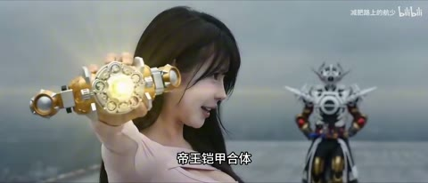

12秒概览角色手持圆形道具，16秒道具中心黄光，20秒腰带接触部位蓝光并有黄白火花；底部白字黑边台词。仅概览，不能确认道具变形/插入操作每一帧的完整性。

复现建议：对现成画面中道具位置做跟踪，叠加发光圆、透镜耀斑和放射短线，按接触时刻给alpha/亮度脉冲。没有证据这些层在本片由后期单独叠加，也可能在AI片段中已生成。

**62—65.933秒 · 球形电场／分叉闪电／环绕能量带**

62.000–62.400秒狗脸近景后，62.467秒变成悬浮全身狗与透明粉色球壳；分叉电弧持续变化。64秒后金橙色环形能量带绕身体旋转，视角和背景逐步改变。闪电分支亮灭和旋转带位置变化不计切镜。

复现建议：基础版可用球面/圆轮廓噪声shader、分段递归折线闪电、多层Glow、环形带粒子；前后环带分层并用主体蒙版遮挡。真实毛发遮挡、球面视差和一致环绕需跟踪/3D素材。

**72—88秒 · 场景置换／金色变身轮廓／装甲显现**

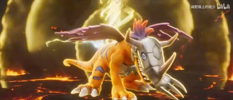

72秒概览从灰色屋顶转到熔岩暗场中的狗，76秒出现强金光的拟人轮廓，80–88秒转成兽形/装甲角色。稀疏概览只能证明这些状态出现，不能证明完整无缝变身或是单段生成。

复现建议：可在已有起止造型之间用强光、烟雾、阈值蒙版遮挡换形；精确骨骼变形、装甲组装需建模/绑定或挑选生成片段，并以连续画面检查。

[完整图文案例](cases/AI14.html) · [原始观察](../evidence/BV1ZdfNBxEbY/REVIEW.md)

### AI15 〖AI末世短片〗秋叶原 - 第一日

类型：营造世界与尺度；题材：科幻／伦理／末世；用途：局部机制／局限参考。

把第一人称空间当连续性问题阅读：道路、车辆和招牌是否帮助定位？无法读懂的文字更适合作局限分析。

**0—24秒 · 幻想森林／第一人称手部／蓝色魔法雾**

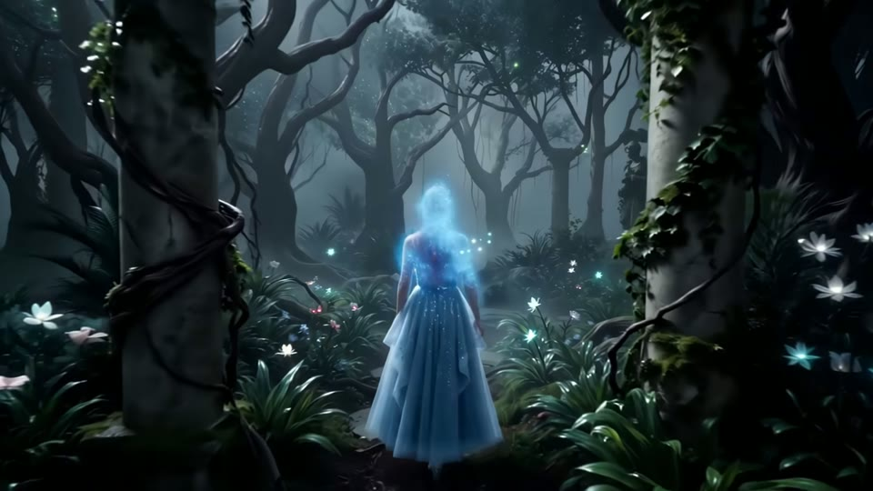

暗森林中发光花和漂浮亮点，手从第一人称视角伸向蓝雾，再见远处裙装人物。

复现建议：场景与人物镜头先制作；简单雾和粒子可叠加，但手与雾的遮挡交互需蒙版或生成。

**32—56秒 · 废墟城市建立镜头／梦境与现实切换**

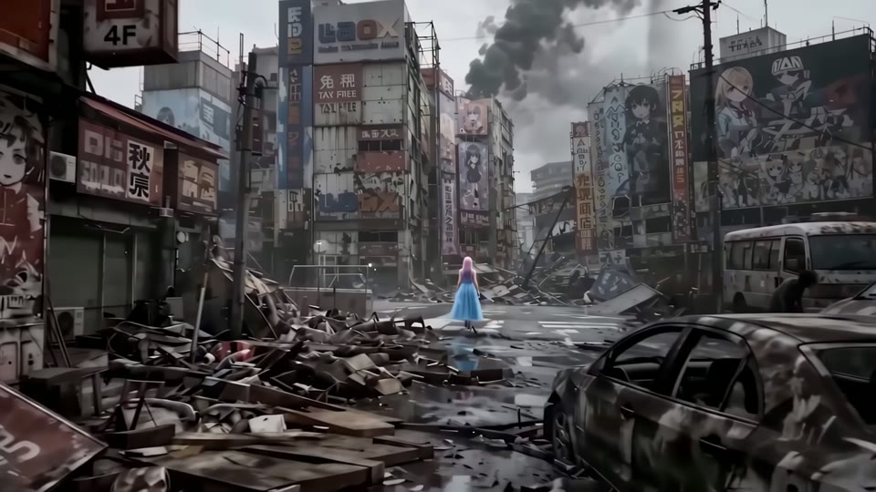

森林过渡到毁坏的秋叶原，汽车、建筑废墟、街道远景交替，随后出现黑场。概览只能描述跨段场景。

复现建议：不同场景镜头按叙事排序，以硬切或黑场连接；烟雾和调色可后期补充。

**64—96秒 · 第一人称车厢对话／战术地图界面**

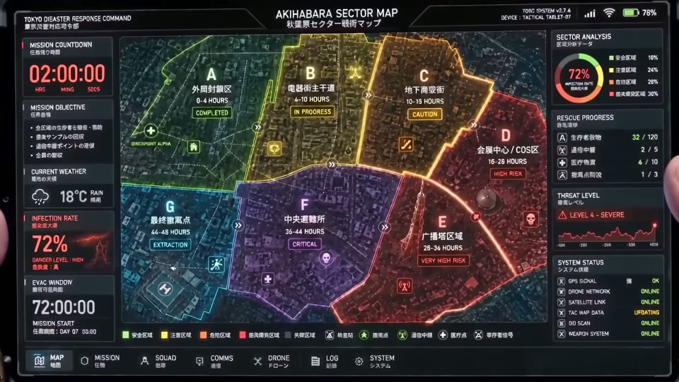

车厢人物近景持续，前景枪和手参与；96秒地图分区、倒计时、信息栏占满画面。

复现建议：对话镜头生成或拍摄，地图用矢量分区、文字和状态条程序绘制；再合成进设备或独立画面。

[完整图文案例](cases/AI15.html) · [原始观察](../evidence/BV1SbJJ6XEcH/REVIEW.md)

### AI16 用DeepSeekFlash-1017花了两亿token画出deepseek眼中的世界！world.execute(me);

类型：信息成为叙事；题材：程序与虚拟关系；用途：局部机制／局限参考。

这条适合研究同源改编：相近代码骨架下，哪些变化属于排版和参数，哪些才是重新设计？不要把复用当独立模型能力。

**0—66秒 · 终端打字机、界面骨架揭示、环形路径排字、数学图形动画**

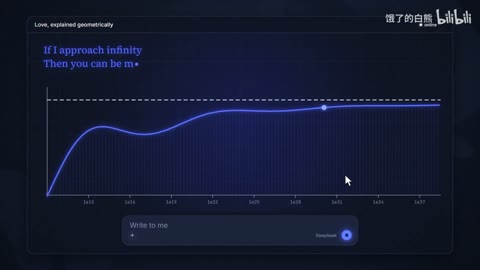

深色聊天界面从线框和占位条转到聊天框，英文标题、歌词和代码逐段显示；36–48秒有点集、环形字、函数图表。

复现建议：Canvas/SVG绘制UI，文字substring或矩形遮罩揭示，按t更新点线坐标；沿圆弧逐字布局

**54—126秒 · 像素化降采样、半色调网点/点阵化**

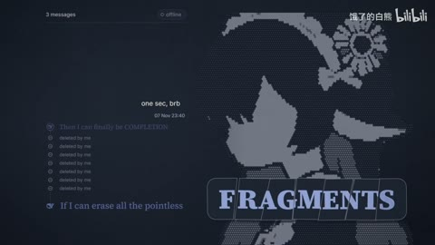

54秒出现低分辨率马赛克；126秒人物呈离散点阵/网点印刷轮廓。

复现建议：先缩小再nearest放大；按亮度阈值或有序抖动绘制圆点/像素

**138—162秒 · 故障弹窗轰炸、界面拼贴、代码逐行执行、计数器**

错误提示和聊天窗口层层叠放，粉红色ILLEGAL ARGUMENTS与EXECUTION反复出现；随后代码行高亮与run计数变化。

复现建议：独立卡片图层按时间出现/位移；确定性排布，代码高亮区横向遮罩，计数floor(time*rate)

[完整图文案例](cases/AI16.html) · [原始观察](../evidence/BV1d2ng6VEg4/REVIEW.md)

### AI17 使用GPT6-Astra和opus5.5生成的world.execute(me)mv

类型：信息成为叙事；题材：程序与虚拟关系；用途：主要视觉研究样本。

从浅桌面到暗色波形、红黑警戒、复古绿桌面，阶段边界可见；角色和通知条作为跨界面联系，真实系统细节不够严谨不影响其作为拟桌面叙事研究。

**0—28秒 · 拟真桌面／通知气泡／窗口层叠／终端标题**

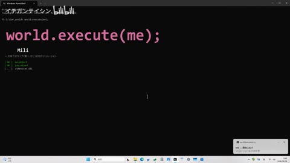

浅色桌面、右侧蓝发角色，上方消息卡，文件管理器/图表/终端层叠；20/24秒黑终端上大粉字。屏内程序和命令仅视频内容。

复现建议：先绘制桌面底图与图标，窗口分别作独立alpha层，按z序及矩形裁切合成，位移/缩放入场；通知标题与头像独立。

**32—48秒 · 绘图软件式数学图形／切线与圆周／多图表界面**

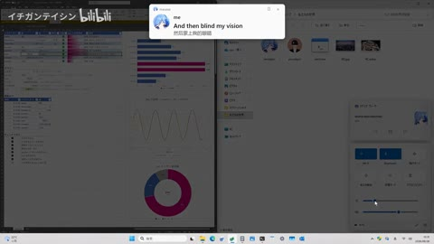

绘图窗依次点阵、圆、曲线切线、波形；背景表格保持，48秒全界面变暗。

复现建议：坐标映射画点线，圆周参数曲线，导数/解析切线数据生成，网格固定；全屏半透明黑层调整明暗。

**52—69.5秒 · 文件图标选择／文件夹状态变化／弹窗隐喻**

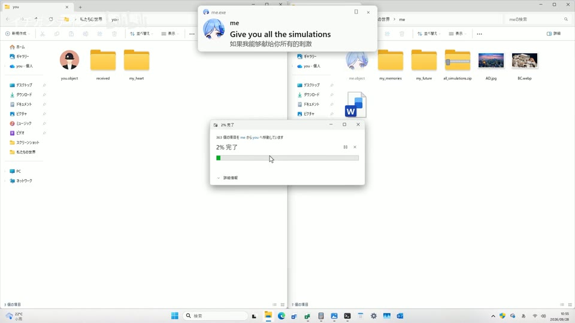

文件夹、图片、文档和人物头像图标出现在文件窗，鼠标/选中框、通知和输入框变化。

复现建议：图标网格按状态显隐，选择框矩形，鼠标按路径移动；窗口文字用统一字体绘制。

[完整图文案例](cases/AI17.html) · [原始观察](../evidence/BV1Siae6tEK9/REVIEW.md)

### AI18 已吓哭 opus5.5真神降临 群论之美宣传片

类型：把抽象变得可见；题材：数学／抽象程序艺术；用途：主要视觉研究样本。

数学大字、白闪和主题场景如何分配注意力？把视觉概念表达与数学正确性分开，这份资料只支持前者的观察。

**4.4—6.4秒 · 白闪串接的数学主题快切／发光衬线大字**

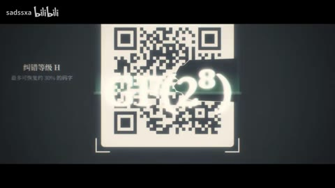

彩色曲线S3、巨额数目、模运算圆图、二维码、椭圆曲线点图、金色镶嵌图依次整幅替换；每次替换有短白闪，大号白色数学符号叠在中心。符号与背景同时更换可算主题画面切换；白闪进出不能各加一次。

复现建议：预渲染主题场景，按时间表硬切；边界叠一段1–2帧高亮白层/快速曝光衰减；文字栅格或矢量渲染后加模糊辉光副本。

**20—44秒 · 金色标题放射光／雪花旋转和反射轴／环形元素与彩格表**

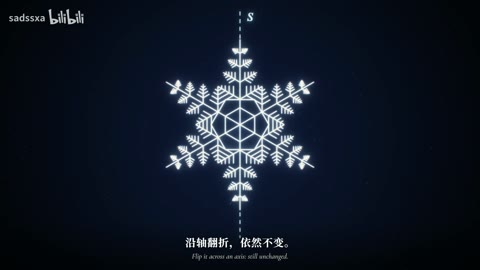

20秒概览金色抽象代数中英标题，24–32秒雪花和旋转弧箭头/虚线轴，36–40秒12个六边形环与彩格表，44秒群字卡。26–30秒细查可见雪花转动后定住，弧箭头淡去、虚线轴淡入，字幕替换，布局没有切镜。

复现建议：用SVG或Canvas绘雪花路径，对组施加旋转/镜像；弧箭头trim-path、虚线和文字独立层淡入；矩阵表格由数据生成，标题用金色渐变和径向光束。

**48—72秒 · 圆周模运算图／时钟变奏／彩虹弦线包络**

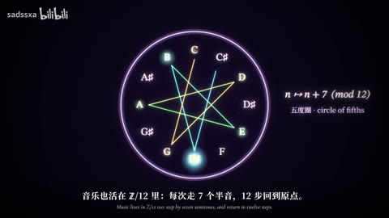

48秒六边形圆环，52秒时钟指针和算式，56秒音名圆环/星形连线，64–72秒密集彩色弦线构成心形、三瓣和多瓣包络。对象形态变化不是自动发生多次切镜。

复现建议：按圆周等分点建立编号，连接n到kn的弦线；k随时间插值，边按索引渐变着色，离屏模糊副本形成辉光。时钟和音名用相同角度映射。

[完整图文案例](cases/AI18.html) · [原始观察](../evidence/BV12Zhm6oE6m/REVIEW.md)

### AI19 病名为𝓐𝓘〖PV〗GPT-6 Astra制作

类型：字体就是画面；题材：程序与虚拟关系；用途：主要视觉研究样本。

诊断档案模板贯穿，左右/上下图文交替、服务器人物群像与品牌环阵使固定系统内有变化；人物形象为独立素材。

**0—12秒 · 黑白诊断档案版式／衬线标题与粗体AI／细线边框**

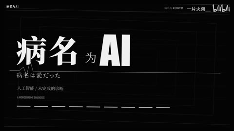

0秒多重细矩形内框，4–8秒中文衬线与粗体英文字结合的标题，12秒进入左字右人物卡；底部双行小字幕与细线组成统一模板。

复现建议：按安全边距定义布局栅格、字体层级、段落锚点和边框；矩形轻旋转/缩放、文字alpha与遮罩揭示。

**12—32秒 · 左右交替图文卡／编号／台词重复纹理**

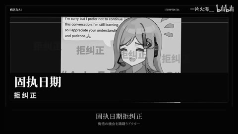

12、16、20、24秒人物卡与文字交换左右或上下；图内有重复小字背景、强调词、编号，底部字幕延续。它们是版式内容，不是当前系统界面。

复现建议：人物图与字卡为独立组，使用预设左右/上图下字布局；背景重复文字降低透明度；编号与文案随时间更新。

**26—30秒 · 全画面波形位移／抖动字形／横向扫线**

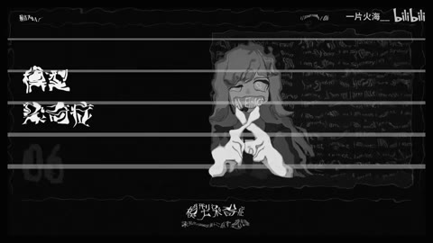

26–27.7秒左文字右人物稳定，27.8开始外框、人物和字行同受波形扭曲，27.9有多条横线；28秒变横幅人物和左下文字，28.1后恢复稳定。扭曲期间多个局部跃变不是多次换镜。

复现建议：先将画面预合成，按y坐标叠正弦/噪声x位移，幅度在转场短暂升高再归零；扫线独立遮罩，随后换布局。

[完整图文案例](cases/AI19.html) · [原始观察](../evidence/BV1XMbN6VE1w/REVIEW.md)

### AI20 Opus5.5一轮对话直出：线性代数之美

类型：把抽象变得可见；题材：数学／抽象程序艺术；用途：主要视觉研究样本。

二维矩阵到流线旋涡、三维线框、分形、网络和词语空间，几何语汇统一但组织尺度有变化；末标题回到透视地面。

**5—30秒 · 向量射线／矩阵网格变形／面积平行四边形／字幕辉光**

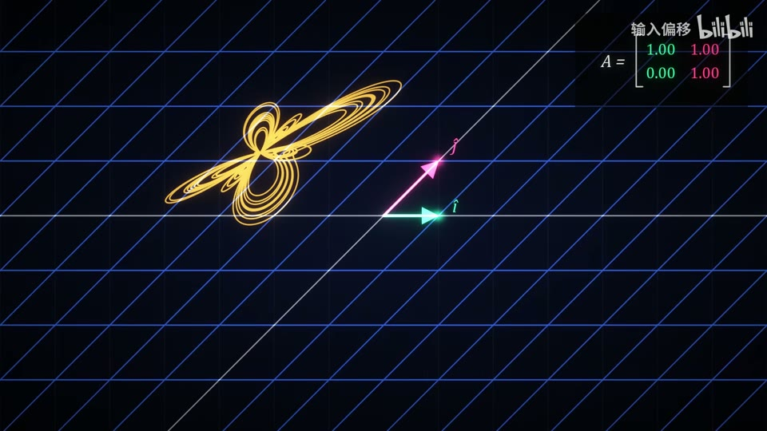

箭头从原点发散，网格与蝴蝶曲线随矩阵变形，平行四边形示意面积后压成直线。

复现建议：对二维点与网格应用矩阵插值，箭头路径加亮点和辉光，字幕独立排版。

**40—65秒 · 向量场流线／彩色旋涡／线框圆环体**

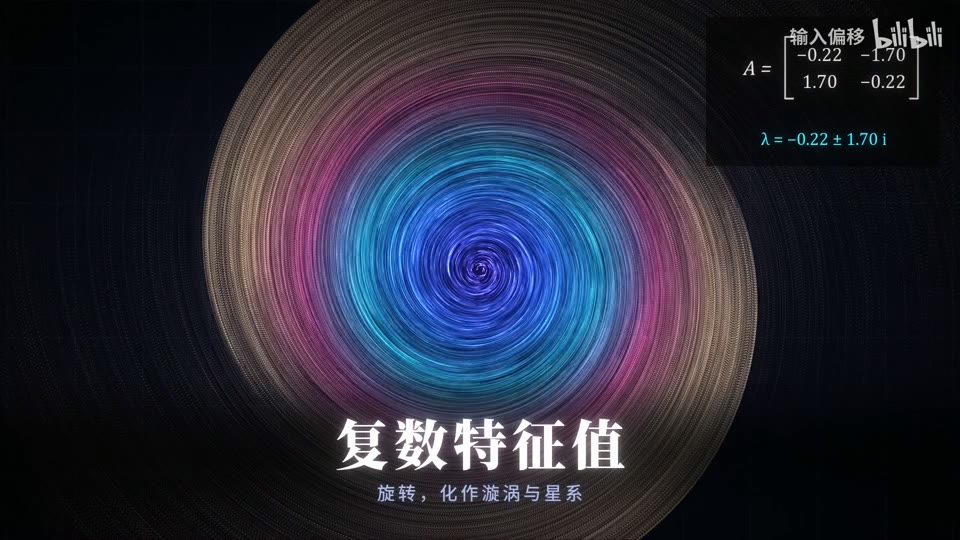

向量基与流线交织，彩色曲线旋成圆盘，之后线框环形曲面与矩阵并排。

复现建议：积分或解析生成曲线路径、轨迹累积；参数化圆环体网格与透视相机。

**71.8—73.8秒 · 线框视图与着色视图闪切／霓虹网格地形**

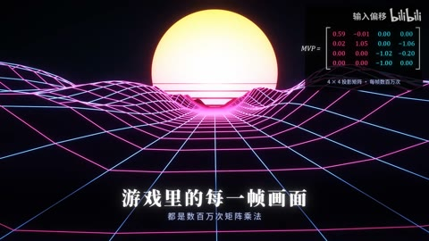

蓝线框透视与紫网格、黄色太阳场景快速交替；字幕和右上矩阵位置固定。

复现建议：同一场景准备线框/着色两个渲染状态，按时间切显隐，地形高度由函数生成。

[完整图文案例](cases/AI20.html) · [原始观察](../evidence/BV1hphd69EDA/REVIEW.md)

### AI21 opus5.5许愿TV 伽罗瓦理论宣传片

类型：把抽象变得可见；题材：数学／抽象程序艺术；用途：主要视觉研究样本。

羊皮纸烛光开场、金粒子标题、青色曲线和暖色群图往复，主元素保持少量，适合图形讲解；不以高速切镜为主要优点。

**0—29秒 · 烛光羊皮纸／羽毛笔书写／双语小字幕**

暖光矩形纸面，左下蜡烛、羽毛笔沿书写区域移动，花体字逐步出现，底部中英双语。

复现建议：噪声/纸纹底图叠暖色径向光，蜡烛火焰alpha动画；字路径描边或字序遮罩，笔尖位置跟随当前字符。

**29—33秒 · 金色粒子聚字／扩散光环／横向镜头光晕**

29秒金点覆盖旧字，30秒粒子逐渐组成中文标题，30.2起圆环扩大，31.1左右字面转连续明亮金色，32秒英文副题渐显。

复现建议：从文字alpha采点，粒子初始随机位置插值到字点，寿命/亮度错峰；薄圆环半径增长降alpha，横线和模糊亮点加色叠加。

**36—108秒 · 青蓝雾场／函数曲线描画／发光节点和表格**

蓝绿暗背景有细网格，42秒抛物线、60秒高阶曲线、66秒复平面点，90秒椭圆连接点，102秒矩阵表格。

复现建议：多尺度噪声云叠粒子，曲线采点连线并用长度遮罩显现；节点小圆加glow，表格按行列动画。

[完整图文案例](cases/AI21.html) · [原始观察](../evidence/BV18yYA61E8f/REVIEW.md)

### AI22 看完想学概率论了：Opus5.5一轮直出，概率论之美

类型：把抽象变得可见；题材：数学／抽象程序艺术；用途：主要视觉研究样本。

骰子统计、钉板、小球、估圆、格点、粒子图标与金色片尾构成分章节视觉；与同UP线代有相同深底辉光语言但内容机制不同。

**5—16.1秒 · 发光骰子阵列／标题压暗背景／渐隐转场**

单颗线框骰子变密集彩色骰子阵列；14.1–15.5秒标题稳定，15.567秒开始渐暗，16秒转空背景。

复现建议：实例化立方体与骰点、随机旋转，标题独立层，背景亮度和透明度包络。

**20—38秒 · 投掷计数／柱状分布生长／曲线描出**

骰子按结果落入列，36–38秒柱形和拟合曲线保持同版式，顶部投掷结果替换、总次数增长，随后淡出。

复现建议：随机数或预设数据驱动柱高、累计曲线、数字和小图标。

**40—80秒 · 钉板落球／曲线图对照／雨点估圆／随机针线**

黄色小球穿过钉板并堆成分布；多组图形对照，圆内外点与估计数同屏，随后针状线段落在平行线之间。

复现建议：二维物理或预设路径、随机采样、图表与计数；理论公式和模拟结果分别验证。

[完整图文案例](cases/AI22.html) · [原始观察](../evidence/BV1GbHi61E9Q/REVIEW.md)

### AI23 【Claude/PV】带我出逃吧，我的罗密欧——Astra制作

类型：人物与图形对话；题材：二次元角色／音乐视觉；用途：主要视觉研究样本。

复古印刷、纸纹和斜切条带如何共同产生舞台与童话气质？尝试从材质一致性理解风格，而不只找某个转场。

**18—19.4秒 · 斜切条带遮罩／局部特写揭示**

深紫底的两只手，换米黄底，再被斜边窄条裁切；局部手指图像随遮罩出现和退出

复现建议：“斜切条带遮罩／局部特写揭示”。矩形或多边形遮罩、位移与缩放可直接实现；骨骼、手部连续动作需要素材或逐镜生成。

**36—42秒 · 歌词大字排版／字号对比**

原始记录将本段标为“歌词大字排版／字号对比”；单帧只辅助定位，完整变化见原审阅记录和摘录。

复现建议：迁移建议：①写清一句主信息；②拆为正文/关键词/纹理；③给每组锚点和入出时间；④先做静态版；⑤仅给承担强调的层加位移、字重或透明度。

**48—66秒 · 纸张质感／复古印刷拼贴**

米黄纸张、复古标签、细曲线、文字透叠、人物与背景分区

复现建议：“纸张质感／复古印刷拼贴／细线装饰”。贴图、字体和图层合成容易，统一美术需要设计。静帧不足以证明精确视差深度。

[完整图文案例](cases/AI23.html) · [原始观察](../evidence/BV1MFpG63E26/REVIEW.md)

### AI24 当你和一百万人一起吃火锅〖AI全民制作人〗

类型：人物关系与叙事；题材：历史／生活寓言；用途：主要视觉研究样本。

超常尺度与日常火锅碰撞产生荒诞感。先读设定与反应，再看字幕、景别和产品插入如何改变叙事重心。

**0—30秒 · 巨构食物场景／超广角俯视／人物近景反打**

巨大圆锅与密集人群、仿仓储建筑的内部空间、菜单巨幅招牌交替；画面呈日漫插画质感，不能仅凭题材称为像素风。

复现建议：场景绘制或生成后进行分镜裁切，维持人物服装、环境透视与比例；剪辑用硬切连接。

**6—8秒 · 正反视角硬切／轻微运镜／对话字幕条**

6秒仍是人物面对镜头；6.083秒换成背影望锅；7.667秒换垂直桥梁俯视。中间同一构图缓慢移动，字幕有替换。

复现建议：镜头表安排前后景别，图像平移缩放，黑色矩形底加白字，按对话分段显隐。

**33.5—35.5秒 · 人物转身视角切换／固定字幕条**

33.5秒人物站在人群中，34秒切其背影俯看调料坑，随后画面缓慢运动；34.167秒附近字幕出现。

复现建议：两幅构图硬切，后续轻微缩放或原动画运动，字幕独立层。

[完整图文案例](cases/AI24.html) · [原始观察](../evidence/BV1CSej6kETr/REVIEW.md)

### AI25 〖Seedance2.0〗AI自制动画《锈月》第一集

类型：动作与冲突的组织；题材：科幻／伦理／末世；用途：主要视觉研究样本。

城镇建立、马车对话、OP战斗与情绪近景的画面语言可辨，但作者已说明零碎片段整理，不能据标题认作完整成熟剧集。

**0—8秒 · 街道建立镜头／低机位景别／动画质感场景**

0秒石板路低机位，4秒半木结构街道与远处尖塔，8秒披斗篷人物中景。源画面是日漫式人物与细致欧洲街景，不因模型署名就可认定全部同流程生成。

复现建议：准备环境总览和人物分镜，利用低机位、纵深和明暗建立场景；现成素材可裁切推拉，真实透视移动需生成或绘制镜头。

**10.5—14.5秒 · 冰锥悬停／轮廓白辉光／背面到正面反打**

10.5–12秒人物背面左右悬有数枚白蓝冰锥，人物转头/回正；12.1秒换人物正面，13.3秒换更宽背面巷道，冰锥仍在两侧。该窗口没有连续飞射，不能只据特效造型称高速弹幕。

复现建议：冰锥可用透明PNG/矢量或简单3D锥体，白色高光加蓝色模糊辉光，按透视位置和人物遮挡分层；两视角分别布置。

**24—84秒 · 攀墙与街头对话／正反打／车轮道具插入**

24秒人物攀墙、28秒回望、40–56秒双人对话与表情近景交替；64–72秒马车内侧脸和双人座位，76秒车轮特写，80–84秒车外人物。主体动作与景别连接承担叙事。

复现建议：镜头表保持服装、方向、车辆空间，按动作/反应硬切；对白白字加黑描边，车轮可用简单旋转层，但车身透视和人物上车需源动画。

[完整图文案例](cases/AI25.html) · [原始观察](../evidence/BV1apc6zXEAG/REVIEW.md)

### AI26 〖原创AI动画〗当全世界所有人都永生不死〖永生世界〗

类型：人物关系与叙事；题材：科幻／伦理／末世；用途：主要视觉研究样本。

科幻设定需要空间、道具和人物反应共同讲清；红白中庭与冷色城市的好看不能替代角色关系和连续性检查。

**0—18秒 · 倾斜建立镜头／坠落动作分镜／红底白色柔光标题**

概览0秒破旧城市阳台，6秒人物翻过栏杆，12秒落地；18秒暗红底白色片名并有轻微红白错位/柔光。坠落画面内动作不是转场插件。

复现建议：先制作阳台、坠落、落地镜头，按时间连接；标题独立文字层加模糊辉光和小幅色层偏移。

**24—36秒 · 圆筒纵深／多人悬浮／蓝色雾化与快速跟随**

29.2–31.133人物在同一蓝色圆筒空间内快速移动、遮挡相机；主要人物大小、前后人物及面貌随时间有明显变化。无法仅凭该窗把每次姿态跃变解释为独立硬切。

复现建议：在3D圆筒内布人物按轨迹运动，或分别生成镜头再审核连续性；统一蓝色调、远景雾和运动模糊。

**42—78秒 · 红白环形中庭／升降管道／俯视几何转场**

58.7–59.833是上升视角，管道口逐渐离开前景、人物向空中移动；59.9换为垂直俯视同一中庭，圆形开口阵列形成几何图案。相机位移和人物飞起不能逐帧累计切镜。

复现建议：建筑圆层用3D阵列或生成场景，设置侧仰与俯视相机后硬切；保持环形结构/灯光一致，前景近物可加景深。

[完整图文案例](cases/AI26.html) · [原始观察](../evidence/BV19iLv6bEKh/REVIEW.md)

### AI27 巨构：光的裂缝

类型：营造世界与尺度；题材：建筑／景观／世界观；用途：局部机制／局限参考。

斜墙、对称谷口、近墙仰视三种构图统一青蓝雾感与微小尺度参照；后半重复前三种布局，新增设计范围有限。

**0—2.948秒 · 巨墙斜向透视／尺度对比／裂缝白光**

大片高密建筑沿斜向延伸，底部绿地与很小的建筑形成尺度对比，墙缝暖白高亮；不是字幕字效。

复现建议：用概念图或3D建筑阵列建立透视，再给裂缝区域单独发光，模糊辉光副本叠加；近景与远景分层。

**3.031—5.439秒 · 对称裂谷构图／青蓝雾化／远端光源**

切到左右巨墙围成的谷口，前景草地小路指向远端白光。低饱和青蓝色覆盖背景，远处对比更低。

复现建议：深度或手工渐变蒙版将远景混入青蓝雾，单独控制曝光、饱和度与暗部；中心光源径向模糊。

**5.522—8.179秒 · 近墙仰视／纵向层叠／雾中光柱**

构图换为左侧近墙、右侧灰蓝雾和窄光束，底部仍有细小建筑。抽样画面内变化很轻，不能据此声称复杂镜头环绕。

复现建议：建筑立面重复阵列、低角度相机和雾体积；简版可对现成图片做轻推拉与光柱叠层。

[完整图文案例](cases/AI27.html) · [原始观察](../evidence/BV1WFEP6eEiM/REVIEW.md)

### AI28 巨构：玄同无待〖AI全民制作人〗

类型：营造世界与尺度；题材：建筑／景观／世界观；用途：主要视觉研究样本。

慢并不等于没有节奏。小人物、建筑框景与云雾让观众逐层读尺度；比较不同停留会如何改变敬畏感。

**0—5.4秒 · 巨型圆门／尺度参照／雾与水流**

极小人物面对巨大圆门和长柱列，暖色门缘对冷灰环境；2.867转白色瀑布墙，人物仍作为比例参照。

复现建议：先有巨构场景图/生成视频；人物尺度、消失点和冷暖光统一；雾、水波可简化叠层，但真实水与建筑关系需素材。

**5.4—15.733秒 · 门框借景／洞口构图／悬浮宫阙**

6–10秒从暗门框看云上红白宫门，12秒石洞围出中央楼阁，14秒长墙高角度。

复现建议：构图以暗前景框出亮主体，层次由前景/主体/云海形成；透明前景加慢推可做简化2.5D。

**16—31秒 · 水面倒影／月亮／云墙／俯瞰**

16–20秒楼阁/长墙倒影和圆月，22–24秒水墙与树，26–30秒高视点柱列云海。

复现建议：镜像裁切与波纹可模拟倒影，云用分层噪声位移；真实透视、建筑和反射一致性需源图/3D。

[完整图文案例](cases/AI28.html) · [原始观察](../evidence/BV1FTMS6cEjW/REVIEW.md)

### AI29 让善恶有报，但由算法控制，你愿意吗？〖AI全民制作人〗

类型：人物关系与叙事；题材：科幻／伦理／末世；用途：主要视觉研究样本。

先找欲望、行动、代价，再看镜头细节。人类预设故事与生成镜头在这里是不同劳动层，不能混为自动成片。

**0—48秒 · 景别交替／门框前景遮挡／底部对白字**

早餐近景到室内全景再到楼道两人；24秒拳套插入，30秒人物前景模糊。文字白色有暗边并较宽字距。

复现建议：按剧情剪镜头；前景虚化优先在源图/视频生成或拍摄中得到，已有景深可保留；字体描边及位置定时。

**48—60秒 · 黑白回忆插入／彩色恢复**

48秒楼道人物，54秒黑白人物与建筑，60秒转学校彩色画面。概览只证实状态，不确定所有入出转场。

复现建议：选回忆片段灰度/降饱和，连接当前叙事；如需柔和连接可做短叠化，但不是已证实作者参数。

**90—130.3秒 · 车内正反打／反应特写／车灯增亮与碰撞连接**

96秒车内正面全景、102秒后排近景、108秒司机背后、114秒另车人物；128.667转惊恐面部后逐渐逼近变亮，129.833转侧窗来车，130.167起碰撞晃动。

复现建议：先分镜生成/选取各机位，时间线上硬切；曝光曲线、局部光晕、短抖动可后加，碰撞动作和玻璃火花须素材。

[完整图文案例](cases/AI29.html) · [原始观察](../evidence/BV1Mbgj69EFu/REVIEW.md)

### AI30 巨构：山海须弥〖AI全民制作人〗

类型：营造世界与尺度；题材：建筑／景观／世界观；用途：主要视觉研究样本。

小塔与远端巨孔构成尺度对照，草原、云海、浮雕人面和瀑布提供不同形体；整体比宫阙红门系列更偏冷蓝与自然地貌。

**0—10.4秒 · 巨构剪影／暖天际／细小人物**

极大塔楼立在雾中，橙黄窄天际衬冷灰塔影，前方人物极小；5.333切有细碎亮点的巨构。

复现建议：构图先确定消失点和人物尺度，用深度遮罩分前景/塔/雾，天际渐变和雾分速移动。

**10.4—25.95秒 · 圆孔借景／层塔／山海云雾**

前景小塔后有巨塔圆孔对着暖天空；15.7换近处层塔，随后高原孤塔与骑马人物。

复现建议：前后层错位形成尺度，圆孔由真实场景或遮罩制作；云层用噪声透明纹理、慢移。

**25.95—37秒 · 云海孤阙／门缝暖光**

山巅暗塔对大云团，31秒后低角度山坡人物走向暖色门缝。

复现建议：长焦式压缩层次、暗塔与亮门对比，门缝光条加辉光；人物行走需源动作。

[完整图文案例](cases/AI30.html) · [原始观察](../evidence/BV1Exg46iETf/REVIEW.md)

### AI31 巨构：缘起性空〖AI全民制作人〗

类型：营造世界与尺度；题材：建筑／景观／世界观；用途：局部机制／局限参考。

圆门、白墙瀑布、侧桥、树影、圆环寺院沿用AI28/32相近构图词汇，单片有视角变化，但新增路线不能与同系列重复累计。

**0—10.55秒 · 圆门／月亮／巨墙瀑布**

红色圆门对圆月和小白衣人物，接俯瞰长墙瀑布，再接崖间塔楼与桥。

复现建议：门框借景、红白对比、微小人物尺度参照；瀑布需要源视频/3D，可简化为流动噪声遮罩。

**10.55—25.906秒 · 浮空门楼／侧向桥梁／树影投射**

巨大门楼在云上，桥绕山崖，22秒长白墙与树影、红色柱列。

复现建议：前景暗/主体亮分层，树影用透明纹理/投影遮罩，云层分速度移动。

**25.906—41.262秒 · 斜构图／洞口落水／巨门仰拍**

倾斜宫阙与圆洞水幕，随后高位长墙，36–40秒暖光巨门仰拍和落水。

复现建议：相机旋转裁切建立斜线，垂直水纹分层；门内外光照和透视需要源图/生成。

[完整图文案例](cases/AI31.html) · [原始观察](../evidence/BV1Rtut6cEBR/REVIEW.md)

### AI32 巨构：行深般若〖天阙纪元〗

类型：营造世界与尺度；题材：建筑／景观／世界观；用途：主要视觉研究样本。

前景松枝、崖台、小人对巨门、长廊消失点、斜阶与中轴桥展示多种透视组织，末段倒影和圆门月轮收束。

**0—5.331秒 · 前景松枝／云上红宫／崖台人物**

红宫与秋树在云海，深色前景松枝框出远景；2.862转岩壁平台上的小红衣人物。

复现建议：前景枝/主体/云海分层，冷暖光与尺度统一，人物作为空间参照。

**5.331—15.706秒 · 巨门云浪／崖中宫／室内天光**

巨大红门两侧云浪，接暖红悬宫与坐姿人物，再接殿内垂直白光束。

复现建议：云浪用噪声位移加分层遮挡；殿内光束用体积感渐变、细尘粒和发光。

**15.706—36.205秒 · 长廊柱列／消失点／雾中人物**

极长红柱廊跨云海，双列宫阙形成中轴，阶梯转弯和人物缓行。

复现建议：透视源图或3D长廊，遮罩分层慢推，深度雾和统一阴影；人物动作由源视频提供。

[完整图文案例](cases/AI32.html) · [原始观察](../evidence/BV1bhuc6VEym/REVIEW.md)

### AI33 巨构：心行处灭〖AI全民制作人〗

类型：营造世界与尺度；题材：建筑／景观／世界观；用途：局部机制／局限参考。

红塔、长殿、暗框门、竹影、金环与白墙盆景形成统一暖灰系列，多个语汇与AI28/31/32重复，作为变体研究。

**0—6秒 · 云上红塔／长殿／尺度人物**

森林孤岛上的红塔转云上长殿，细小人物形成尺度对比。

复现建议：深度雾、前中后层、缓慢相机运动与暖冷光。

**6—16秒 · 暗框亮门／竹影暖墙／圆孔取景**

深色装饰边框围住巨大红白门与竖向亮光；转竹影金墙、圆孔内远门。

复现建议：前景框遮罩、软发光、阴影纹理及圆形遮罩分层。

**16—32秒 · 悬空长廊／云海／红色圆门**

长廊横跨云崖，金墙树影接厚墙中的红色圆门与岩石。

复现建议：透视构图先由源图确定，云雾噪声位移，远近层有不同运动速度。

[完整图文案例](cases/AI33.html) · [原始观察](../evidence/BV1wyuG6PEXH/REVIEW.md)

### AI34 Claude热唱：《您的账号已被封禁》

类型：字体就是画面；题材：二次元角色／音乐视觉；用途：主要视觉研究样本。

橙红黑人物海报保持统一，前台人物、证据墙、背影看板三种结构有功能区分；末绿/红点阵强化数量变化。

**0—8秒 · 海报式标题揭示、描边字幕、标签式排版**

橘黑插画底图变暗，右侧白色粗体标题配黑描边与细横线，英文装在白条内；人员表逐步出现

复现建议：现成插画+暗色透明罩+字体描边+位置/透明度关键帧

**12—56秒 · 截图卡片拼贴、证据墙、印章砸落**

统一橘底人物立绘上不断叠加网页/邮件/聊天卡片，卡片有投影、轻微旋转和前后遮挡；部分盖红色封字印章

复现建议：截图裁切、2D旋转缩放/平移、drop shadow；盖章加快速缩小与轻微回弹

**59—61秒 · 转场**

约60秒变为黑底英文大字。81.1–82.967秒主体基本稳定，83.033秒出现偏白的新构图，属于白色亮闪辅助换场，而非连续高速换镜

复现建议：白色遮罩alpha脉冲+底图切换，按帧调持续时间

[完整图文案例](cases/AI34.html) · [原始观察](../evidence/BV1Hzpm6hEaY/REVIEW.md)

### AI35 巨构：被遗忘者

类型：营造世界与尺度；题材：建筑／景观／世界观；用途：主要视觉研究样本。

通信碟、机械弧门、双塔、云中垂物和环臂构成科幻工业形态，区别于同UP宫阙红门；色彩维持蓝灰红关联。

**0—7.5685秒 · 低明度冷蓝／红色巨构／深度雾**

草原城市上红色高塔、碟状天线与伞状红光建筑，阴云开隙。

复现建议：蓝灰调色、红色局部发光、前中远层雾、天空光束渐变。

**7.5685—12.6419秒 · 红色机械弧门／白色体积光／环状巨物**

巨大红色机械弧门向地面投白光，后转俯视盘绕式巨物。

复现建议：弧形源素材分层，锥形柔光+雾和粒子，镜头缓慢移动。

**12.6419—18.8381秒 · 双通信塔／红裙状塔基／烟雾**

双高塔布满天线，顶部烟气；转红色伞裙状塔基和多层光点。

复现建议：原塔体先确定，烟雾纹理流动与点状光层，缓慢镜头。

[完整图文案例](cases/AI35.html) · [原始观察](../evidence/BV1ZTJ76FEAD/REVIEW.md)

### AI36 原创AI漫剧《恶仙》第一集，中式克苏鲁风格

类型：动作与冲突的组织；题材：东方奇幻／怪诞；用途：主要视觉研究样本。

红云异象与冷暗院落对照，半透明人群、莲花与花内建筑形成尺度/隐喻变化，后段信息揭示靠景别顺序。

**0—36秒 · 黑底提示／红黑环境／书法标题**

开头黑底白字红色重点，4–28秒红云火光和异象眼睛，32秒暗红大书法，36秒左侧白色竖向书法。

复现建议：文字独立渲染为透明层，红/白分色，按版面安排；背景红黑可调色统一，但复杂异象需源图。

**40—72秒 · 对白字幕／主客观镜头和正反打**

少年、老人、手持纸张细节交替，白底字幕居下，景深与灯笼背景维持。

复现建议：剪全景/人物近景/道具插入，字幕描边定时显示；景深主要依赖源素材。

**76—84秒 · 透明发光人群／水面反射**

蓝白半透明人形行走，边缘高亮，水面亦有影像；84秒转蛇尾细节。

复现建议：抠人像降alpha，边缘提取加glow，镜像翻转/透视与波纹置换做简化倒影。

[完整图文案例](cases/AI36.html) · [原始观察](../evidence/BV1uUfmBAEtc/REVIEW.md)

### AI37 原创AI漫剧《恶仙》第二回：诸天倾塌妖门开，万恶噬生炼狱来

类型：动作与冲突的组织；题材：东方奇幻／怪诞；用途：主要视觉研究样本。

室内母子反打到古城红门、月下戏院、钱币/手细节，扩展同系列空间；灰红团队片尾与正文区分。

**0—44.95秒 · 黑底说明／眼部极近景／冷暗室内反打**

说明字卡后眼部特写，怪物、孩子和母亲的近景反打，人物脸有伤痕和暖火色。

复现建议：字卡直接排版；源画面提供人物与空间，曲线压暗、局部暖光和浅景深。

**44.95—78.35秒 · 城市俯拍／红云巨门／巨大阴影**

灰色古城转红云与天门，巨大形体遮过街区，接俯视人群和举兵器怪物。

复现建议：城市源图或3D、云层、暖光、前景暗影遮罩；不同视点按尺度递进连接。

**78.35—98秒 · 红雾吞没／飞行怪物／燃烧建筑**

红色雾遮挡后怪物横过空中，牌坊和殿宇燃烧、碎片落下。

复现建议：红雾噪声位移，火焰/火星粒子和景深碎片；遮挡需跟随建筑。

[完整图文案例](cases/AI37.html) · [原始观察](../evidence/BV18KAhzbE7C/REVIEW.md)

### AI38 《恶仙》第四回：此身已堕无间狱 化作仙门嗜血粮

类型：动作与冲突的组织；题材：东方奇幻／怪诞；用途：主要视觉研究样本。

怪诞感既来自材质，也来自看与被看的景别关系。脸、手、全身、眼和泪滴的转换，比单纯增加血肉细节更值得学习。

**0—32秒 · 黑底说明／赤色书法片名／燃烧寺院**

黑底说明后是暖橙火寺院与白发怪物，24秒附近红色恶仙片名叠武器和人物。

复现建议：文字排版、笔刷字体、透明度和轻推；火寺院主要为生成场景。

**32—112秒 · 发丝触手／缠绕／多眼血肉武器**

白发如粗触手掠过并缠人，人物跃屋顶，武器有眼和牙。32.7窗口为连续追踪白发至眼球。

复现建议：生成镜头或角色/毛发模拟，再作选镜、稳定与合成；不能用普通转场替代复杂遮挡。

**112—136秒 · 红色地面电环／刀光／残烬**

武器触地伴红色电环，红刀光横扫发丝，人物落地持剑。

复现建议：路径光条、分叉线、加色辉光、粒子与跟踪遮罩；身体动作需源片。

[完整图文案例](cases/AI38.html) · [原始观察](../evidence/BV1CEQmBTEmY/REVIEW.md)

### AI39 〖永生世界02〗为什么全世界所有人都永生不死〖AI全民制作人〗

类型：人物关系与叙事；题材：科幻／伦理／末世；用途：主要视觉研究样本。

区分按钮、装置和人物动作的因果，与晶体抬镜、光束和拉远的连续运动；自动检测峰值并不一定是剪点。

**0—15秒 · 霓虹城市／红白标题／下方字幕**

头部受伤角色起，10秒未来城市上有大红白标题与集数；后续白色小字幕。

复现建议：城市源图/视频加独立字层，偏移副本形成厚度/红影，字幕按时间淡入或硬切。

**33—46秒 · 矿晶反光／连续抬镜／暗部层次**

红色晶体与镐头特写，镜头沿手臂抬到矿工脸；背景矿洞暗灰衬红。

复现建议：分层静图可做简化平移/遮罩和辉光，但真实手臂、镐头、空间连续运动需生成或动画。

**50—74秒 · 实验容器／发光DNA／浅景深**

透明圆柱内动物与DNA符号，容器由中性变红亮；白鼠近前景虚化、实验者远处。

复现建议：容器先有透视素材，符号以screen/add叠加跟踪；不同层模糊模拟景深。

[完整图文案例](cases/AI39.html) · [原始观察](../evidence/BV1KSE965EqR/REVIEW.md)

### AI40 原创AIGC剧集《有异人》第二集〖AI全民制作人〗

类型：动作与冲突的组织；题材：东方奇幻／怪诞；用途：主要视觉研究样本。

潮湿未来城市、床边日常、纸马、摩托细节、港口与像素片尾多种段落，人物反应与道具串联。

**0—30秒 · 潮湿未来城市／景深／冷暖色**

工作台小生物、街道人物、湿地反射、远近城市建筑形成空间层次。

复现建议：先有场景/人物视频，统一冷灰城市与局部暖光；景深遮罩和调色可叠加。

**34—54秒 · 悬浮小生物／镜面／纸张飞行**

床边小生物悬浮，随后洗脸人物与反射、楼间跳跃和黄色纸张。

复现建议：分层生物加轨迹与投影，纸张可粒子或3D薄片；人物反射需匹配视角。

**102—120秒 · 白色笔刷标题／斜向构图**

巷道背景叠有异人第二集白色笔刷题字，字幕为独立下方小字。

复现建议：使用授权毛笔字体与透明遮罩揭示，背景旋转裁切和字层分别控制。

[完整图文案例](cases/AI40.html) · [原始观察](../evidence/BV1qmMR6MEMW/REVIEW.md)

### AI41 〖新宿决战〗第一话 seedance 2.0 制作

类型：动作与冲突的组织；题材：动作／武侠／英雄；用途：主要视觉研究样本。

高密度动作窗仍需回答“谁对谁做了什么”。查看视点、动作方向与接触结果，不把生成素材已有连接全算后期新增。

**0—30秒 · 漂浮碎石／紫色光球／城市爆炸／漫画拟声字**

白发人物悬于霓虹城市，碎石浮动，指端紫光球引发远景爆炸，黑色拟声大字覆盖烟团。

复现建议：生成城市和人物运动，粒子碎石/发光球/烟雾合成，拟声字独立变换。

**30—72秒 · 极近景对话／手势插镜／蓝色边光**

嘴部、侧脸、手势和衣服局部轮换，再接蓝边光人物特写。字幕位于黑边内。

复现建议：多景别语义剪接、统一字幕安全区和色彩；面部/手部动作需源镜头。

**72—108秒 · 紫色贯穿光束／高速拳脚／橙色撞击火星**

光束穿楼，人物近身格斗，橙色火花与蓝白光束随碰撞迸发，随后楼内穿行。

复现建议：生成或动画格斗和空间镜头，轨迹光条、加色粒子、径向模糊作强化。

[完整图文案例](cases/AI41.html) · [原始观察](../evidence/BV1ZuZMBhERy/REVIEW.md)

### AI42 〖新宿决战〗第二话 seedance 2.0 制作

类型：动作与冲突的组织；题材：动作／武侠／英雄；用途：主要视觉研究样本。

城市翻转和白色斩击可在同镜内产生巨大变化。把空间运动、特效覆盖与真正换镜分开，是判断节奏的基础。

**0—35秒 · 接上集／球形黑域／白色径向爆光／漫画字**

开头复用第一话末段格斗手势，黑球罩城市，边缘红紫光带，白线向中心聚集；巨大双斩线穿球。

复现建议：圆形mask、噪声光边、径向线和十字路径可以合成；城市球体关系需源镜头。

**35—58秒 · 红色刀痕／面部伤口／旋转城市斩击**

人物挥手伴红色斜痕，伤口近景后是连续翻转城市与长条白色斩击，碎片沿视点飞过。

复现建议：斜向路径与辉光、人物局部纹理；空间翻转需3D或生成，碎石遮挡另合成。

**58—80秒 · 监看室解释／漂浮红块／怪物寺庙**

对话室有红色方块浮动，插入带角、眼、牙的巨大庙宇，后回群像。

复现建议：生成场景与叙事剪接，简化方块粒子加景深可后制。

[完整图文案例](cases/AI42.html) · [原始观察](../evidence/BV1V6ZrBJEoM/REVIEW.md)

### AI43 〖新宿决战〗雨爱 AI制作〖B萌应援〗

类型：动作与冲突的组织；题材：动作／武侠／英雄；用途：局部机制／局限参考。

同系列镜头再编排可改变情绪和密度。观察复用如何服务新段落，同时保留其不是独立新生成流程的事实。

**0—12秒 · 霓虹废墟／紫色巨球／漫画城市／手势**

人物和紫色巨球、黑白漫画城市、白发人物手势轮换，与系列前两话存在明显相同画面。

复现建议：系列镜头再选取，紫球可圆mask+辉光简化；原人物/城市场景由生成素材提供。

**12—30秒 · 高速拳脚／贯楼光束／烟团碎石**

角色近身对打与楼间追逐、贯楼光束、灰烟碎石远近交替。

复现建议：语义选镜与空间动作素材，光束/颗粒/烟叠加可增强。

**30—45秒 · 手部发光／极近脸／撞击火花／车厢战斗**

极近脸部、蓝光手与双人侧景快速连接，随后橙红火花格斗和城市碎裂、手势拟声字。

复现建议：短镜拼接、漫画字与径向光粒，原格斗和空间变形需生成。

[完整图文案例](cases/AI43.html) · [原始观察](../evidence/BV1JuMB6FERb/REVIEW.md)

### AI44 [opus 5.5] world.execute(me);

类型：信息成为叙事；题材：程序与虚拟关系；用途：主要视觉研究样本。

低位深启动界面逐步变彩色，点云成形、角色换装、递归与逐层拆解建立可见状态序列；统一绿发角色和紫环维持联系。

**0—28秒 · 系统启动／复古窗口／棋盘透明底／位深提升**

黑底转小窗口、启动文字和环线，8–16秒大字卡与属性窗，20秒紫色光环，24秒大量彩色UI和电路板。

复现建议：按时间轴绘制窗口/位图字体/进度条，低分辨率画布最近邻放大与调色板量化，发光环叠加。

**32—60秒 · 点云聚形／坐标网格／数学曲线／波形扭曲／羽翼**

32秒散点成环，36秒点云人物，40–48秒正弦/公式/黄色辐射线；52秒整体波纹弯曲，60秒彩色矢量人物与双翼。

复现建议：从角色轮廓采样点，插值位置聚合，曲线按参数方程绘制，像素坐标正弦扰动；羽翼由重复叶片/羽毛路径分组。

**64—74秒 · 状态条堆叠／代码底纹／角色保持**

黄色状态条逐层增多，角色主体与紫色环基本保持，代码字在底部叠层。

复现建议：列表图层按时序出现，进度条遮罩，等宽文字裁切滚动；不需真实执行代码。

[完整图文案例](cases/AI44.html) · [原始观察](../evidence/BV1vthX6XEwm/REVIEW.md)

### AI45 第38届百花奖AIGC推优 最佳短片《断鞘》

类型：人物关系与叙事；题材：动作／武侠／英雄；用途：主要视觉研究样本。

长篇短片的局部好画面不等于全片表演通过。学习景别与叙事任务，保留未连续观看的证据边界。

**0—132秒 · 冷蓝雪战／前景武器／宽近景交替／火焰**

雪城墙与士兵、弓箭、兵器接触、撞门木、火焰和人物反应交替；底部中英字幕。

复现建议：先生成/取得统一人物和雪城场景镜头，再按战场空间连接；雪可粒子、火可透明素材叠加，真实战斗调度与衣甲动作需生成/3D。

**144—216秒 · 竖排书法人物介绍／冷暖室内对照**

144秒人物旁书法少将军名牌，168秒另一人物书法老将军名牌，烛火暖光与窗外冷光形成反差。

复现建议：书法字体/字形透明图层竖排，短淡入与遮罩；烛火辉光可以合成，但完整人物光照与材质来自源片。

**228—372秒 · 山地建立镜头／骑行群像／物件反应插入**

雪山、城墙、骑马三人、人物表情、倒地人物、飞鸟依次建立空间；构图和段落远近切换明确。

复现建议：选用环境远景、队伍中景、人物近景/道具插入；慢推/轻摇可由已有分层图简化，完整骑行/飞鸟需视频素材。

[完整图文案例](cases/AI45.html) · [原始观察](../evidence/BV1rTKU6WEat/REVIEW.md)

### AI46 原创自制连载〖AIGC〗浮光第五集！

类型：动作与冲突的组织；题材：科幻／伦理／末世；用途：局部机制／局限参考。

这是修整而非盲目模仿的材料：将清楚的电光/动作连接，与作者承认的赶工瑕疵、画面白块分别记录。

**0—18秒 · 前情动作／白底竖排片名／对白字幕**

开头橙色城市人物战斗，12秒白底红书法名与竖排第五集，18秒人物近景底部中英字幕。

复现建议：片名为文字排版与简短进入/退出，字幕可ASS/Canvas渲染；人物和城市视频由生成素材提供。

**24—60秒 · 追逐低机位／武器能量束／面部反应插入**

24秒腿部奔跑、30秒机器人俯身、36秒车头双蓝光、42秒光束穿前景，48秒面部与亮球。

复现建议：动作分镜选用远/近/道具/反应素材；简化光束以路径、发光核心、边缘噪声和镜头光晕合成。

**87—91秒 · 悬浮符文／蓝色能量链／环绕光带**

87秒蓝菱形符文及电弧，88.3转全身人物，蓝路径先成高环再绕身旋转，90.7转人物近景与前后链条。

复现建议：符文用矢量路径和辉光；环绕带用螺旋参数曲线投影，依前后深度分层遮罩，电弧加入扰动。

[完整图文案例](cases/AI46.html) · [原始观察](../evidence/BV1kicszZEwY/REVIEW.md)

### AI47 Seedance2.0官方先导片

类型：人物关系与叙事；题材：多题材展示；用途：主要视觉研究样本。

星空漂浮、舞厅、卡通群岛、玩偶舞台形成不同媒介段落；服装与双人关系作为锚点，场景丰富度不能仅归功剪辑转场。

**0—15.333秒 · 暗场渐暗／黑底双语小字／人物近景**

暗蓝观众与暖台灯逐渐变暗，9秒黑底双语小字，12秒人物近脸与星点背景。

复现建议：曝光/透明度渐暗，黑底文字排版；前景人物接星空需人物遮罩或生成镜头。

**18—31秒 · 星空悬浮／粒子年份变形／人物剪影**

两人星空漂浮，23.7转较宽拥抱构图，24–25.4粒子2016，25.6–26秒数字粒子重排成2026；主体逐渐暗成剪影。

复现建议：将字形采样为粒子目标，配对插值+扰动和辉光；人物分层/遮罩保留前景，单独降低曝光，星背景缓移。

**33—48秒 · 舞厅群像／冷暖转场／双人反应／舞台光**

舞厅多人跳舞、舞台周年标识，之后双人反应近景与暗舞台光束。

复现建议：生成或选取群舞/舞台镜头，保持服装与人物，宽景接反应；舞台光束可噪声体积光或透明渐变。

[完整图文案例](cases/AI47.html) · [原始观察](../evidence/BV1vec5zJEiA/REVIEW.md)

### AI48 萌宠拆家！Seedance武侠动画！《侠影宠梦》

类型：人物关系与叙事；题材：动作／武侠／英雄；用途：主要视觉研究样本。

武侠幻想与真实宠物的反差，依赖落点和回收。水墨、打斗和日常拖鞋的材质变化，应服务反转而不是各自炫技。

**0—3秒 · 纸纹／墨迹标题**

米白纸纹上墨色笔刷题字和灰墨扩散，片尾亦重复。

复现建议：纸纹底图+透明墨迹序列或噪声扩散遮罩，授权书法字体揭示。

**3—33秒 · 拟人毛发／茶馆反打／景深**

白猫与黑犬以武侠装束对坐饮茶，近景/过肩/双人，后有女子。

复现建议：角色、服装和场景需稳定生成或3D；分镜用景别/视线组织，远景虚化。

**36—81.4秒 · 月夜剪影／跳跃／刀光与冲击尘**

大月亮与屋顶构图，角色跳跃、双刃相接、白色弧线和尘碎片。

复现建议：刀光用跟踪曲线/残影，冲击粉尘用粒子；完整空中缠斗和屋顶空间依赖源视频。

[完整图文案例](cases/AI48.html) · [原始观察](../evidence/BV1sMPgzaE19/REVIEW.md)

### AI49 Seedance武侠动作尝试，确实不一样。结尾附流程

类型：动作与冲突的组织；题材：动作／武侠／英雄；用途：主要视觉研究样本。

片尾给出了参考图与分时段动作输入。可把它当分镜约束教材：先明确机位和动作任务，再讨论生成工具。

**0—7秒 · 雪景气氛／人物亮相／景别推近**

0秒雪原全身、2秒雪尘、4秒白衣人物、6秒面部与斗笠特写；衣带、头发和雪粒形成运动层。

复现建议：以角色/场景参考图生成镜头；后期雪可用不同深度粒子、景深与风向轨迹，人物动作/面部需要源视频。

**8—13秒 · 武器飞行特写／白色弧形枪影／腾空动作**

8秒空中短刃，10秒马与车，12秒腾空人物持枪，周围白色弧形轨迹。

复现建议：先取得飞行与腾空源片；弧线可将武器端点路径延长成白色带，alpha和宽度随寿命减小，再加辉光/运动模糊。

**14.7—16.7秒 · 环绕机位／近景武器碰撞／火星**

14.7人物侧脸，随后背肩见来敌；15.7对手正面刀枪相接，15.767–15.833火星散开；16.233起较宽双人构图。

复现建议：碰撞点用少量短寿命线粒子，速度沿扇面分布；镜头和人物动作按参考与时段生成，剪接保留动作方向。

[完整图文案例](cases/AI49.html) · [原始观察](../evidence/BV1AQcvzbEd1/REVIEW.md)

### AI50 Claude用代码搓了13015帧4K视频然后吃了你13亿Token

类型：把抽象变得可见；题材：数学／抽象程序艺术；用途：主要视觉研究样本。

点云、星系、环与字符空间如何维持视觉中心？这里的程序几何与文生视频是不同路径，执行规则不等于自动获得叙事。

**8—16秒 · 发光电路线／点云**

线与半透明点云构成空间，亮度和密度帮助区分层次。

复现建议：线段/点云几何，亮部辉光与固定时间更新。

**25—27秒 · 螺旋星系／俯侧视变化**

粒子星系在俯视和侧视间改变视角，主要为同镜相机运动。

复现建议：螺旋臂分布、透视相机与轨道路径。

**64—66秒 · 透视网格／空间曲线**

规则网格、曲线和文字提示空间深度。

复现建议：点线几何配透视相机、遮挡和适度景深。

[完整图文案例](cases/AI50.html) · [原始观察](../REPORT.md)

### H01 败犬温水的七次败北之旅！

类型：信息成为叙事；题材：青春／情绪／成长；用途：主要视觉研究样本。

同构图内头像依次加入，就是关系信息的增加；它不需要被夸写成七次切镜。学习信息渐进和中心人物的稳定。

**15—15秒 · 手机备忘录UI／屏幕替换**

手机备忘录样式“恋爱败北记录”，七项名单

复现建议：“屏幕替换／UI贴图”。平面静态卡容易，贴合倾斜手机需四角透视变换及遮罩；只据概览不认定完整跟踪已核验。

**40—40秒 · 人物竖条多分屏**

三个人物的狭长竖条并列，标A/B/C，右侧黑底

复现建议：“多分屏／人物条带拼贴”。裁切、位移及标签可直出；人物细抠视素材而定。

**108.19—109.53秒 · 环绕头像／错峰入场**

蓝天底主角抠像，周围圆角人物头像按顺序出现，约108.19、108.44、108.69、108.94、109.11、109.28、109.53秒逐步填满

复现建议：“头像环绕／错峰入场／角色关系图”。这是用户参考封面的动态来源。贴纸、描边、标签、排布和错峰时间线容易直出；主角与头像需合适素材／遮罩。连续入场属于一个构图的图层更新，不计七次换镜。

[完整图文案例](cases/H01.html) · [原始观察](../evidence/BV1eb4MegEqf/REVIEW.md)

### H02 夏

类型：人物与图形对话；题材：青春／情绪／成长；用途：主要视觉研究样本。

蓝黄粉几何要与人物轮廓、视线和动作一起读。关键是色块面积与前后层次，既学风格，也避免把原片片头全算UP新增。

**2.5—2.77秒 · 孟菲斯几何拼贴／人物遮罩／弧形框**

用户参考图匹配：蓝色人物半身、蓝黄粉孟菲斯几何拼贴；圆环、斜线三角、细线和弧形外轮廓

复现建议：Canvas/矢量图层做图形、遮罩和旋转缩放容易。角色抠像与轮廓检查需要素材准备；不承诺任意动画自动无瑕抠像。

**3.2—3.6秒 · 几何遮挡揭示转场**

高密度三角、条纹、圆点铺满屏幕，再逐渐让出人物；可称“几何图形遮挡转场／拼贴揭示”

复现建议：用带独立位移旋转的几何图层覆盖切点，然后退出；机制容易，元素密度、色彩、人物前后遮挡需要设计。

**4.4—5.4秒 · 双色描边标题／手写名与涂鸦**

大号蓝白、粉白日文标题；手写风人物名、白线涂鸦环绕人物。连续更换背景构图

复现建议：字体描边、双色填充、文字和涂鸦分层可以直出。标题看起来属于所用片头设计，不能断言UP自行制作；不能把字体样式等同于已核验逐字动画。

[完整图文案例](cases/H02.html) · [原始观察](../evidence/BV1px4y1s7sn/REVIEW.md)

### H03 崩 溃 边 缘

类型：动作与冲突的组织；题材：科幻／伦理／末世；用途：主要视觉研究样本。

脸与眼的窗口对位、枪火段和字标段分别承担不同任务。先拆清原动画动作、局部拼贴和故障字，才知道自己应制作哪一层。

**16—24秒 · 矩形局部拼贴/画中画**

眼睛与人物/机甲局部在矩形区域中叠压原背景；20秒和24秒抽帧可见多层矩形错位拼接。

复现建议：裁切矩形素材为多层，位置/缩放关键帧，必要时遮罩；已有源素材可较容易代码导出。

**56.3—58.3秒 · 枪火、玻璃碎裂和电弧的高频变化**

56.3至57.033秒车内人物构图基本连续，黄光线和玻璃裂片变化；57.1秒附近变为机枪特写，57.633秒附近转为机械臂，58.233秒出现新人物。

复现建议：应先区分原动画动作和作者新增效果；不能把每次枪火闪烁算作剪辑转场。对应片源可直接裁切重排；独立重制人物/玻璃需复杂素材或动画。

**93.9—94.9秒 · 赛博朋克故障字卡/扫描错行**

霓虹青绿斜切Logo置于黑底，随后蓝色与粉红色水平块撕裂覆盖，字标换色、RGB色散和噪点，背景多次色块跳变。

复现建议：文本/Logo透明层，复制RGB通道错位，水平条带遮罩位移，噪声贴图，有限帧随机seed；指定字形需合法Logo或自己重画。

[完整图文案例](cases/H03.html) · [原始观察](../evidence/BV17K4y167nK/REVIEW.md)

### H04 “予你花束，予我遗忘”

类型：让静止画产生空间；题材：青春／情绪／成长；用途：主要视觉研究样本。

同一房间的前后时间与画稿形成关系；特效可以克制。学习相同镜位如何承载失去、成长与记忆，而不是只看效果密度。

**4—12秒 · 居中双语细衬线歌词／暗场排版**

较细白字置于画面中央，日文主行和中文小行分层；人物暗色背景。

复现建议：字幕分层、字号对比、阴影及透明度；暗化背景可用亮度曲线。

**16—24秒 · 多分屏／漫画画稿拼贴**

16秒雪景、房屋与车门分为不同矩形；20秒铺满素描姿势；24秒人物被黑色窄条分区。仅概览，不推断全程转场轨迹。

复现建议：矩形遮罩、不同源裁切与分层显隐。

**32—40秒 · 同一房间的时间对照／镜位匹配**

相近室内构图里，人物与光线、窗外景色发生变化，保留房间骨架形成前后呼应。

复现建议：选同角度片段对齐裁切、叠化或硬切；叙事效果来自素材选择。

[完整图文案例](cases/H04.html) · [原始观察](../evidence/BV15hW3zNECn/REVIEW.md)

### H05 【静止画MAD/海虎】地心引力

类型：让静止画产生空间；题材：动作／武侠／英雄；用途：主要视觉研究样本。

黑白漫画、红黑冲击、山景云海和白场尾声有疏密反差，人物尺度变化和墨迹/条带组织前后层次。

**8—20秒 · 黑白漫画分层／山景合成／暖色眩光与网点**

概览8秒人物立在漫画山崖并叠暖色光斑；12秒城市、16秒雪山配章节小字，20秒剪影云海有网点。概览不足以确定层间真实视差。

复现建议：先将漫画人物、山崖、天空分层，关键帧推拉；叠噪声、网点与模糊光斑。真实雪山需素材。

**24—28秒 · 红黑双色／竖排白字／横向黑白条带**

27–27.3秒红黑画面缩放；27.4秒转黑白头像与竖排白字，27.9–28秒两条黑带跨脸滑入，间留细白线。

复现建议：灰度和阈值建立黑白底，选定区域红色着色；文字逐字纵排，矩形图层按时间滑移，细线独立叠加。

**28.1—30.9秒 · 横向拉伸模糊／平铺插帧／竖条开窗／局部反色**

28.1–28.2横向模糊连接横构图，28.7–28.9短暂出现漫画重复平铺；29–29.2手臂置于窄白竖条，29.3后为手部近景；30.8眼部同图反色一瞬，30.9换剑柄。反色不计新镜头。

复现建议：单帧或短序列平铺成网格，遮罩裁出竖条；方向模糊与scaleX快速变化形成拖拽，反色用颜色反转。

[完整图文案例](cases/H05.html) · [原始观察](../evidence/BV1fyJhzHEvr/REVIEW.md)

### H06 【静止画MAD】让驱魔师免于堕落

类型：让静止画产生空间；题材：动作／武侠／英雄；用途：主要视觉研究样本。

立绘放入透视棋盘与建筑剪影，前景锁链/碎片制造遮挡深度；暖光与灰白空间的组合统一。

**12—28秒 · 漫画抠图拼贴／局部着色**

漫画人物抠像置于粉、红、白色块；链条前景、棋盘地面、黄眼和暗部轮廓

复现建议：“漫画抠图拼贴／局部着色／前后景遮挡”。已有图层后基础合成容易；人物拆分、补画和统一光影需准备。

**80—84秒 · 漫画立绘空间化／透视地板**

人物分立在透视棋盘地面前后，相互遮挡，布局有深度

复现建议：“漫画立绘空间化／透视地板／相机编排”。可用Three.js平面贴图或Blender相机实现；需抠图、深度排序、相机和边缘处理。

**85—87秒 · 能量折线／菱形阵列／加法辉光**

橙白发光折线、光球、重复菱形列阵在棋盘空间中变化，末尾人物大形状进入

复现建议：“能量轨迹／重复几何阵列／加法辉光／遮挡转场”。基础折线和阵列容易，复杂空间镜头与人物遮挡中等至较难。每束光的闪动不算换镜。

[完整图文案例](cases/H06.html) · [原始观察](../evidence/BV1mo4y1t7A7/REVIEW.md)

### H07 致，我最后的热泪盈眶[静止画MAD/风华回战2022]

类型：让静止画产生空间；题材：青春／情绪／成长；用途：主要视觉研究样本。

纸纹高留白、漫画小窗、宽幅天空、黑场停顿和舞台背光交替，后段散大字与片尾圆形半色调延续平面语言。

**0—17秒 · 高留白／纸面颗粒／小字双语文案／窄幅漫画窗**

4/8秒白底黑小字和细颗粒；12秒画面右侧人物与左文案，16秒简笔标题。

复现建议：白底纸纹叠低alpha噪声，左右栅格排版，漫画裁切为窗口，字体分中文主行与小英文副行。

**20—48秒 · 条带裁切／三连重复人物／前景虚化与平移**

20秒侧背人物构图，24秒细横幅漫画，28秒同人物重复三份，32秒方形人物窗，44秒漫画与礼堂淡叠。

复现建议：矩形蒙版与复制排版，图片分层位移，加适量高斯模糊模拟景深，叠化连接空间。

**55—57秒 · 甩镜模糊／大字与人物分层／黑条收缩与黑闪**

55秒窄幅眼部，55.067起大范围方向模糊，55.267新人物配橙蓝底与散大字；56.267黑上下边增厚，56.533/56.8短黑帧后回同一画面，文字更换。

复现建议：先快速平移/旋转加运动模糊遮接点，人物与字分层；蒙版高度压缩，插黑帧，底部词块独立替换。

[完整图文案例](cases/H07.html) · [原始观察](../evidence/BV1SV4y1T7ZM/REVIEW.md)

### H08 【咒术回战/静止画MAD】我们的罪与罚

类型：让静止画产生空间；题材：动作／武侠／英雄；用途：主要视觉研究样本。

漫画着色、浅景深、城市叠层、废墟人物与暗字森林提供空间/材质变化，原动画与静止画混用需分层归属。

**0—12秒 · 比赛包装／大字透视／红黑封面**

4秒大MAD字和虚线矩形、8秒角色与比赛标，12秒红黑题图。

复现建议：文字透视/挤出假厚度，图像窗与线框排版，红黑双色映射。

**16—44秒 · 横向画幅遮罩／城市叠层／描边字／线稿反相**

多段图像以宽条显示，32秒城市上标题、36秒暗背景描边字、40秒城市亮线与说明。

复现建议：上下遮罩、源片缩放/平移、文字描边，边缘提取/反相与光感纹理。

**48—124秒 · 漫画着色／浅景深／漏光／纵向对白**

漫画人物局部着色、暖光、暗角、背景虚化；60/64秒竖排文字；124秒两人中央、黑白图案环绕。

复现建议：人物/背景分层并补洞，色块与光影遮罩，前景模糊层模拟景深；对白独立排版。

[完整图文案例](cases/H08.html) · [原始观察](../evidence/BV1oP4y1x7dv/REVIEW.md)

### H09 咒 术 实 战

类型：人物与图形对话；题材：动作／武侠／英雄；用途：主要视觉研究样本。

人物与街景不是抠出来放上去就够了。透视、光向、遮挡与环境色共同决定虚实是否可信。

**0—12秒 · 实景与漫画角色合成／冷暖分区／染色高亮**

东京街景、公交与小巷中叠动漫人物，蓝/紫/橙灯光与人物着色互相呼应，9秒蓝线形构件覆盖楼体。

复现建议：人物抠图/描边，跟踪实景机位、匹配透视和大小，遮挡物遮罩；人物边缘按环境光染色，加接地阴影。

**12—16秒 · 故障条带／RGB错位／拆笔画字／黑色字底块**

12.012蓝色大标题，12.1–12.7多条水平错位块；12.763起黑矩形上白细笔画拼入，间或巨大笔画闪现，15秒左右版面较完整。整个底图是同一街景构图。

复现建议：标题透明层切为字/笔画或矩形切片，按时间显隐；当前图复制横条横移，RGB通道小幅分离，字底黑块独立。

**18—33秒 · 旋转甩镜／倾斜画卡／镜像万花筒**

18秒实景旋转模糊，30秒黑底多张倾斜画卡带方向模糊，33秒街景被多向镜像成几何拼接。

复现建议：组层快速旋转平移并加运动模糊；复制视频做三角/扇形蒙版、镜像与旋转，构成万花筒。

[完整图文案例](cases/H09.html) · [原始观察](../evidence/BV1n34y1r7rx/REVIEW.md)

### H10 祥 另一个幸福的我！

类型：信息成为叙事；题材：二次元角色／音乐视觉；用途：主要视觉研究样本。

紫火跨场景门与年代对照、路线头像、任务条和生日群像服务平行世界二创情节，UI有明确用途。

**0—6秒 · 年份与平行世界字幕／固定叙事标签**

0秒画面中央白色年份/平行世界标记，4秒年份移至左上；背景人物和教室来自动画素材。

复现建议：定时文字层设中心或左上锚点，年份与世界标签跟随剧情切换，字号和描边保证可读。

**6—10秒 · 紫色火焰传送门／轮廓消失／跨场景连接**

7.007起人物附近窄紫火扩大，7.257–7.424前景头发拉长离开，火焰环持续变化；8.342换咖啡馆并保留前景紫门，9.426后门放大、人物半透明出现。门变化不是每步切镜。

复现建议：椭圆/不规则环的噪声位移加紫粉辉光，前景透明人物做水平拉伸与位移；在切场后复用门层，人物alpha渐显。

**20—92秒 · 彩色对白气泡／文字层级／人物反应重编**

概览24、36、48、56及64–92秒在人物旁有不同色圆角对白框；20秒大白字对白、60秒下方强调标题。对白是二创内容，不当作原作台词或真实用户指令。

复现建议：圆角矩形加尾角/文字，按角色设配色，手工控制锚点避免遮脸；定时替换文本并留阅读停顿。

[完整图文案例](cases/H10.html) · [原始观察](../evidence/BV1V5KPerEL3/REVIEW.md)

### H11 因为会时停，所以耗时0秒！带上耳机，见识一下反派的漆黑意志！

类型：动作与冲突的组织；题材：动作／武侠／英雄；用途：局部机制／局限参考。

方向拉丝、旋涡、扫描线、通道偏移与源动画攻击动作结合，属于动态混剪语汇。

**8—20秒 · RGB边缘色散／重影叠化**

概览可见人物边缘红青彩边，16秒人物手臂有半透明重影。

复现建议：分离RGB通道少量位移，复制前后帧降低不透明度。

**32—40秒 · 方向模糊／径向旋转变形**

32秒横向拉丝，40秒中心形成旋涡状扭曲与模糊；只据概览不认定完整转场轨迹。

复现建议：方向模糊、缩放模糊、极坐标或旋涡位移。

**48—48秒 · 倒带符号／扫描线／画面波形弯曲**

左上有双左箭头，人物画面呈横向扫描线和弯曲轮廓。

复现建议：符号叠加、逐行水平正弦偏移、隔行亮度网纹。

[完整图文案例](cases/H11.html) · [原始观察](../evidence/BV1zb4y1z7jW/REVIEW.md)

### H12 『 天 堂 制 造 』

类型：字体就是画面；题材：二次元角色／音乐视觉；用途：主要视觉研究样本。

前段星空雨线与文字建立信息节奏，后接漫画卡片推进、黑场字卡降低密度，图文分段明确。

**0—48秒 · 星空雨线背景／白色书法字幕／括号排版**

前段多张概览持续同一星空底与竖线，中心逐句更换白色字幕；不以每句换字计换镜。

复现建议：视频背景或粒子底＋字体图层；透明度、位置与缩放关键帧。

**48.1—48.4秒 · 反相闪帧／局部色相变换／漫画揭示**

星空切人物眼部，再出现黑白高反差和短暂负片形态，随后双人漫画构图稳定。

复现建议：短时反相与阈值化、遮罩和裁切、调色；时长需按原帧调试。

**49.667—49.933秒 · 文字碎裂故障／字标揭示**

中文“神父”后，英文Made In Heaven先呈碎条状，再组成可读白字；人物构图延续。

复现建议：把文字切为横条，随机水平偏移及透明度后归位。

[完整图文案例](cases/H12.html) · [原始观察](../evidence/BV1xP4y1s7t7/REVIEW.md)

### H13 【奇蛋物语MAD】蜕变的稚气

类型：让静止画产生空间；题材：青春／情绪／成长；用途：主要视觉研究样本。

扫描线暗场、撕纸与石纹拼贴、留白飞散字形成多种段落；人物踩字面和递归框将文字纳入空间关系。

**16—32秒 · CRT扫描线／色散错位／汉字笔画残影**

人物和大号汉字带红绿蓝边，画面覆盖横扫描线，32秒字与人物被纵向条纹拉开。

复现建议：RGB通道偏移、扫描线透明纹理、噪声驱动切片位移。

**36—48秒 · 文字包围人物／递归画框／撕纸边／小窗拼贴**

人物前后有大字与细线，40秒多个倾斜框套住中央人物，48秒粗糙纸边分割角色与字幕。

复现建议：透明人物图层配背景大字，矩形副本等比缩小旋转；纸纹遮罩和子画面。

**52—80秒 · 石纹开裂／几何分割／线框叠层／相机界面**

灰石纹被人物轮廓打断；60秒横竖矩形切片分割人物，68秒取景框围住角色。

复现建议：纹理位移与遮罩、矩形切片、线框矢量和相机UI叠加。

[完整图文案例](cases/H13.html) · [原始观察](../evidence/BV13P4y1s7ti/REVIEW.md)

### H14 【静止系MAD】从今往后无人再说芦毛跑不快！「小栗帽/赛马娘」

类型：让静止画产生空间；题材：运动／竞技；用途：主要视觉研究样本。

漫画格、窗格阴影、锁链和粒子空间连接赛场人物，静止画层次与运动方向互相呼应。

**28—32秒 · 双色墨流字幕卡**

蓝、红纯色底上有黑色墨流／烟流，中心小白字

复现建议：“双色墨流字幕卡”。有烟墨素材可调色合成；程序流体可做近似，不能保证即刻生成同等细节。

**48—48秒 · 锁链前景／竖排字**

人物在红色链条网络中，链条分前后层，旁边细竖排字

复现建议：“锁链前景／剪影层级／竖排排版”。链条图形可重复排布；精确遮罩和空间层级需要设计。

**132—132秒 · 玻璃多边形／粒子空间**

透明多边形层叠，内有粒子点和亮线

复现建议：“玻璃碎片感／多边形粒子空间”。基础多边形和粒子可编程；真实折射、复杂相机和角色层级要调试。

[完整图文案例](cases/H14.html) · [原始观察](../evidence/BV16G4y1F7Dd/REVIEW.md)

### H15 【芙莉莲/静止系MAD】想不想看花海盛开

类型：让静止画产生空间；题材：青春／情绪／成长；用途：主要视觉研究样本。

餐桌上人物逐项消失与空间留空的关系，比花瓣数量更有表达力。试着通过“少了什么”理解时间和缺席。

**16—24秒 · 留白人物拼贴／竖排明体字／落叶前景**

白底人物远景、小幅竖字、近景人物与蓝色叶片层叠；24秒大号竖排字压在多人漫画前。

复现建议：准备透明人物图层，设位置缩放，文字按竖排排版；叶片沿不同速度和深度运动。

**28—32秒 · 玫瑰装饰框／局部红光／暗场立绘**

28秒漫画边框布满花朵，手中剑或宝石局部发红；32秒人物被大形体围住并受方向光照。

复现建议：花框和人物分层、局部遮罩发光、亮度/投影渐变。

**37—39秒 · 暖冷闪光／局部去色／近景替换**

黑底竖字后切女性侧脸，暖光变冷色、又去色；38.2秒转到兜帽近景，亮光再次扫过。

复现建议：原素材裁切、色温/饱和度关键帧、渐变曝光遮罩与少量RGB错位。

[完整图文案例](cases/H15.html) · [原始观察](../evidence/BV1c3411K7Mt/REVIEW.md)

### H16 章鱼噼的原罪【bilibili创作大赛/风华回战2023/静止系MAD】

类型：让静止画产生空间；题材：青春／情绪／成长；用途：主要视觉研究样本。

漫画走廊的连续推进可以形成叙事压力。分层、门框和前景遮挡应共同引导观看，而非按每次位置变化计新镜。

**4—12秒 · 眼形遮罩／红色碎片／漫画人物分层**

眼睛轮廓包围人物，随后出现红色破片与近景人物上的细红线。

复现建议：人物和漫画背景拆层，眼形路径作遮罩，碎片多边形位移，线条描边与发光。

**28—32秒 · 环绕排字／图形标志／黑底留白**

章鱼图形与问号居中，红字分布周围；概览确认版式，未证明各字运动轨迹。

复现建议：文字层沿环形分布，位置和旋转关键帧，中心图形单独控制。

**48—64秒 · 次数计数牌／红墨飞溅／漫画纹理叠入人物**

48秒白色大字显示次数，背后漫画与红色墨迹；64秒人物轮廓内出现漫画纹理。单帧不能证明数字递增。

复现建议：数字文本、墨迹遮罩、人物蒙版与纹理双重曝光合成。

[完整图文案例](cases/H16.html) · [原始观察](../evidence/BV1h34y1c7U9/REVIEW.md)

### H17 『章鱼噼的原罪 | MAD | 被生命所厌恶』

类型：让静止画产生空间；题材：青春／情绪／成长；用途：主要视觉研究样本。

人物特写、黑场留白、多窗口、线网和白刷遮罩构成统一图形语言。

**0—24秒 · 环境建立／原动画镜头串联／分屏与小字幕**

0–20秒森林、步行、教室、人物背影；24秒左上和右下两人物画面，余下区域黑底小字。背景自然运动可能继承原片。

复现建议：选现成动画镜头硬切，按矩形裁切到对角位置，黑底文字按时间显示；统一级别的底字幕。

**28—76秒 · 倾斜字行／大小字错落／描边字／黑色逐字底块**

概览多处白字斜穿人物；58.25起斜字行扫入，58.667起局部大字带黑色方底，字的大小、位置与底块不同步变化。它们是图层内排版变化。

复现建议：逐字符独立锚点、字号、旋转与起止时间；字轮廓可描边，底块按字体包围盒绘制，组层沿斜线位移。

**58—62秒 · 同镜头三态闪烁／重复画面切片／画中画累积**

59.25–60.083同人物在正常色、红黑划痕和负片状态交替；60.25转宽景，61秒后局部动作画面条块叠入，61.417加人物近景，61.667近景卡放大。

复现建议：对当前镜头复制正常、灰度反色和红黑三版本按帧交替；矩形区域裁切复制素材，逐层叠入并放大。

[完整图文案例](cases/H17.html) · [原始观察](../evidence/BV1Ra8jz8EmW/REVIEW.md)

### H18 死去的记忆在攻击我【崩溃星穹】

类型：动作与冲突的组织；题材：科幻／伦理／末世；用途：主要视觉研究样本。

眼位对齐和大脸／小窗的比例，帮助密集游戏CG保持焦点。参考谱系和原CG光效应从新增拼贴中分开。

**0—13秒 · 黑场／真人引子／游戏CG／暗横条**

短黑后真人访谈字幕，转角色与高彩夜景，人物脸部有横向暗条。

复现建议：语义选材、基本剪接与半透明矩形条；真人字幕可能来自源节目。

**13—17秒 · 眼睛对位／矩形嵌套／横竖分屏／线稿插帧**

不同角色眼部用矩形窗逐层覆盖，接双眼满屏、左右分屏、中央横条、叠套小窗，再接双色脸和黄色线稿眼睛。

复现建议：按眼睛位置缩放裁切，多矩形mask错峰出现，水平/竖直布局和线稿阈值；精确源图需准备。

**17—39秒 · 动作选镜／瞳孔近景／柔光／短窗覆盖**

游戏战斗、眼睛特写、霓虹角色与明亮光束远景轮换，36附近虚焦光爆，39处小窗覆盖广景。

复现建议：原游戏CG选镜与画中画、柔光/缩放/模糊；原招式/粒子单列来源。

[完整图文案例](cases/H18.html) · [原始观察](../evidence/BV1eC41147Vx/REVIEW.md)

### H19 【泛式/误解向】我的一色彩羽妹子果然是女主——比企鹅X一色的恋爱日记

类型：信息成为叙事；题材：二次元角色／音乐视觉；用途：主要视觉研究样本。

游戏菜单、选项和相册将动画重新组织成关系叙事。高速窗能证明短裁切执行，但较慢能量段和后记承担不同任务。

**12—60秒 · 恋爱游戏对话框／选项／鼠标高亮**

彩色姓名条、对白框和选择项；28秒主菜单鼠标与绿色按钮发光，29.53起人物介绍卡，54秒大字选项。

复现建议：矩形圆角图层、文字逐字/淡入、指针路径与按钮外发光，菜单放大到下一卡；对白需按素材语境编排。

**28—32秒 · 菜单推镜／方向模糊／角色名牌滑入**

28.862起菜单放大，29.446接近按钮，29.53过渡模糊、29.613角色蓝底介绍；名牌与数值条从右进入，31.6起白光/花瓣掠过。

复现建议：整体缩放/位移和方向模糊，人物透明抠图叠蓝色纹理，文字牌条用缓动进入，最后白色粒子/光片遮罩。

**42—54秒 · 重复大字／圆形头像／参数化角色卡**

42秒人物周围重复文字，48秒圆头像配模糊数据，54秒选项强调。

复现建议：文字复制与深度/缩放错位，圆形遮罩、背景高斯模糊、不同字号/颜色层级。

[完整图文案例](cases/H19.html) · [原始观察](../evidence/BV1Cs411z7qN/REVIEW.md)

### H20 【鸢一折纸】折纸大师的千层套路

类型：人物关系与叙事；题材：二次元角色／音乐视觉；用途：主要视觉研究样本。

低特效密度也能有表达：反应镜头、道具和前后关系是核心。若只追求复杂转场，会错过语义重组的价值。

**0—4秒 · 圆形头像／火环片头**

黑底头像周围橙黄色环状火光，下方紫色描边署名。

复现建议：圆形裁切头像，环形噪声遮罩加发光与沿圆周流动；署名描边淡入。

**4—94秒 · 宽画幅／粉色字幕／语义选段**

主要用动画全景、人物反应、表情特写串联；下方黑边有粉色描边字幕，有的字幕亮度渐变。

复现建议：固定上下留边，授权字体填充/描边，透明度关键帧；根据动作和语义选段。

**26—28秒 · 反应插窗／表情夸张**

茶杯接双人，再出现横条表情窗口扩张到大脸，随后回双人。

复现建议：可用裁切矩形、缩放和边缘亮线模拟插窗；原素材也可能已包含该动画处理。

[完整图文案例](cases/H20.html) · [原始观察](../evidence/BV13E41117ys/REVIEW.md)

### H21 戰 回 術 咒

类型：动作与冲突的组织；题材：动作／武侠／英雄；用途：主要视觉研究样本。

有限红色与灰黑底形成风格骨架，空间动字和冲击帧围绕人物动作组织。先理解色彩与方向，再复制插件外观。

**0—32秒 · 红白动力文字／透视厚度**

灰黑场景上红白英文词随画面构图出现，部分斜置、具厚度和前后字层。

复现建议：独立文字层做透视、偏移副本假挤出，逐字或逐词揭示，关键帧安排位置。

**32—40秒 · 选择性去色／眼部红色横光**

森林与角色多为灰白，红衣领保留；眼部横向红光跟随人物。36秒附近夹多次极短黑帧。

复现建议：颜色范围遮罩去色，跟踪眼部位置叠光条和辉光；黑帧独立事件处理。

**44—52秒 · 波纹扭曲／色散／横向条带**

局部画面呈虹彩边缘、液体波纹和横向位移带。

复现建议：噪声/正弦位移贴图，RGB通道微偏移，分条带偏移并在峰值替换底图。

[完整图文案例](cases/H21.html) · [原始观察](../evidence/BV1wB4y1w7Lm/REVIEW.md)

### H22 影视飓风那些无法超越的片段

类型：用素材建立新联系；题材：纪实／旅行／品牌；用途：主要视觉研究样本。

长停留访谈、暖色空镜、幕后与成片、快速高反差镜头形成疏密差异；同题材镜头延续语义。

**0—32秒 · 访谈长镜头／底部描边字幕／中心金色强调字**

日落边坐姿人物保持较长构图，中段穿插工作场景，32秒中心金色短句与底部白字形成层级。

复现建议：字幕按句显隐、描边阴影，中心强调句另设字号、颜色与字距；必要时压暗背景。

**36—56秒 · 暖色空镜串联／黑场留句／人物剪影**

飞机、石滩、渔船、日落剪影连续出现，56秒黑底只保留字幕。

复现建议：按色彩与叙事选择原素材，硬切与短淡出，保留字幕跨镜头延续。

**64—140秒 · 主题蒙太奇／地球插图／拍摄工作与旅途交替**

地球画面、人物近景、船上背影、工作镜头、高空气球设备依次出现；字幕和右上来源文字辅助叙事。

复现建议：按文本主题建立素材索引、镜头表；来源标注单独排版，图像插入与裁切。

[完整图文案例](cases/H22.html) · [原始观察](../evidence/BV1kT421r7vE/REVIEW.md)

### H23 不用画面,做个高燃混剪

类型：字体就是画面；题材：二次元角色／音乐视觉；用途：主要视觉研究样本。

纯文字也能产生强度：词义、字号、密度和停留共同工作。检验文字是否真能被读懂，而不只觉得画面在变。

**0—2秒 · 黑场留白／白字淡入**

0秒为纯黑，0.083秒起居中白色粗体标题渐亮；0–1.919秒没有切换成动作场景，主体是标题透明度变化。

复现建议：纯黑背景+居中粗体文字，alpha按约定区间渐变；按画布宽高计算锚点，确保字距、对比度和阅读停留。

**3—63秒 · 极简字卡／主副标题层级／黄色提示行**

概览显示大量黑底居中白字，部分下方配黄色小一号解释行；21秒双短句分置左右，54秒短句放大。文字描述镜头而非真的出现英雄/火炮等画面。

复现建议：为字卡定义起止时间、文本、字号、对齐、行距、颜色；整卡替换或追加副行。黑场和留白也是版式，应保留可读停留而非不停增加动效。

**5.005—6.924秒 · 字卡硬替换／拟声词独立强调**

5.005–6.173秒保留白色标题和黄色说明，6.256秒整卡换成居中白色拟声词；无需闪白、缩放或复杂转场。此处是字卡内容替换，不是实拍镜头切换。

复现建议：在确定时间关掉旧文字层并显示新字卡；拟声词可单独设字重和位置，时间表以秒或帧对齐。

[完整图文案例](cases/H23.html) · [原始观察](../evidence/BV1Tp4y147fj/REVIEW.md)

### H24 【三代恶灵骑士/高燃/混剪】前方高能！红蓝地狱烈火燃烧着我们不屈的复仇之魂！

类型：动作与冲突的组织；题材：动作／武侠／英雄；用途：主要视觉研究样本。

蓝火是可研究的选择改色；骷髅、火焰几何和链条动作主要来自影视素材。分清“改色”与“创造动作”，才能正确估计制作量。

**0—24秒 · 黑白高对比／局部保色／角色名牌**

前段人物、马和环境多为黑白高对比，部分暖色/红色标识保留；12秒白化剪影，20秒人物和环形名牌。

复现建议：饱和度/曲线与颜色或人物遮罩组合；文字圆环和牌条用独立图层。

**4.129—6.048秒 · 白闪／阈值化轮廓连接**

牛仔转马蹄高反差构图，近5.7秒白闪、5.881秒宽构图；阈值闪烁和马运动不逐个计为新镜。

复现建议：短曝光曲线或白色叠层；阈值/色阶抽取轮廓后与源片混合，连接处少量帧变亮。

**24—72秒 · 人物细节／道具／环境穿插**

面部、手、坠落、斧头、墓地和病床交替，背景多灰，火和皮肤偏暖。

复现建议：先按叙事功能挑选反应/道具/环境镜头，再统一黑位和主色；并非每次插入都需要转场插件。

[完整图文案例](cases/H24.html) · [原始观察](../evidence/BV1L4411375f/REVIEW.md)

### H25 电影混剪 | 愿你有一天终将与重要的人相遇

类型：用素材建立新联系；题材：青春／情绪／成长；用途：主要视觉研究样本。

连接的力量来自相遇、凝视和接吻等共同意象。摄影原本已经优秀，剪辑者的表达在于选择、顺序和停留。

**0—7.667秒 · 黑底白字引子／居中留白／字卡替换**

开头黑底中央为小号白色中文短句，0–1秒同一句，1.333秒换下一句，3.000秒再次换句，4.333秒变成长行，7.333秒已进入人群实拍。没有在所查开头采样中确认复杂文字粒子或描边弹跳。

复现建议：定义字卡文本、起止时间和居中锚点，纯黑背景按时间替换；保持统一字距与阅读停留。采样3次/秒不能断定每个切换是否有短暂淡化。

**17.1—19.033秒 · 电影画面直接切接／景别与色彩对照**

17.100秒仍为人物近景，17.167秒直接变为黄花田中的小人物远景；17.167–18.967秒花田构图持续；19.033秒直接变成人群场景。没有在这两个所查边界发现遮罩、闪白、RGB故障等过渡帧。

复现建议：按入出点裁切素材并拼接，优先选主体位置、景别、色彩和情绪有对照的画面。素材原剪点可能包含在取段内，未比对原电影，不能全部归为UP新增切点。

**24—354秒 · 底部中英双行字幕／白字轮廓与阴影**

多个概览片段在画面底部或黑边内出现中文主行、英文小行，部分字体发浅蓝或带深色边缘；也有只中文或完全无字幕的片段。样式并非全片统一。

复现建议：可用ASS/字幕渲染器设置中英字号、行距、描边和下边距；字幕先标注角色/文本和起止点，再渲染。现存字可能已烘焙在所用电影资源，未比对源片，不能断言全由UP新排。

[完整图文案例](cases/H25.html) · [原始观察](../evidence/BV1q441177e9/REVIEW.md)

### H26 【全程高燃/综漫/燃向】见过黑暗的人 才明白什么是光明

类型：动作与冲突的组织；题材：动作／武侠／英雄；用途：主要视觉研究样本。

多番角色战斗按动作和冷暖交替连接，收尾转明亮近景形成段落收束。

**0—6.5秒 · 立体方盒片头／粒子／虚焦／人物字幕**

片头盒形图案居中，周围蓝色粒子；后为红瞳人物特写和小号白字幕。

复现建议：盒体透视或3D，粒子运动模糊、镜头景深；字幕居底。

**6.5—34秒 · 多番战斗选镜／冷暖反差／小字幕**

冲刺、抬脚、结印、人物对话等素材连接，场景由冷蓝转灰紫和金黄。

复现建议：选取动作起止点、裁切与基本调色；原动画动作保留。

**34—66秒 · 激光弧线／飞散火花／红光白闪**

红色武器光弧、紫蓝剑光碰撞、红色爆发和双人战斗。

复现建议：简化效果可用发光曲线、粒子、曝光闪；须跟踪武器端点与人物遮挡。

[完整图文案例](cases/H26.html) · [原始观察](../evidence/BV1Lb411i7qo/REVIEW.md)

### H27 【色彩电影混剪】四色东方

类型：用素材建立新联系；题材：纪实／旅行／品牌；用途：主要视觉研究样本。

按色彩组织电影素材时，仍要检查人物、形状和主题是否支持连接。颜色是关系线，不该成为忽略语义的借口。

**4—4秒 · 黑白建立画面／竖排纸条标题／细金线边框**

灰阶树与屋檐上叠白色竖条、中文片名，画面边缘细金线，底部小署名。概览仅确认版式。

复现建议：字幕层、竖条矩形、细线和署名，背景去色。

**8—56秒 · 同色系镜头串联／红色主导／材质与动作关联**

红布、红花、红唇、刀尖红滴和衣袖舞动形成同色序列；主要是素材选择与构图，未观察到必须依赖复杂转场的证据。

复现建议：挑选主色相近且动作/构图有联系的源镜头，色彩匹配、裁切和硬切。

**60—104秒 · 暖金色段落／门框形状匹配／画面方向延续**

暖色地板、服装和树林连续出现；73–75秒多组门框与中央人物交替，竖直边线及中心对称把不同镜头联系起来。

复现建议：按形状和主体位置选镜头，统一中心裁切，再按节奏切换；画面内部开门属于源素材动作。

[完整图文案例](cases/H27.html) · [原始观察](../evidence/BV1zs411Y78A/REVIEW.md)

### H28 嗦嗦 嗦嗦嗦嗦嗦

类型：动作与冲突的组织；题材：动作／武侠／英雄；用途：主要视觉研究样本。

眼部内嵌人物、面部红网格和词语错峰定位有图文设计，火墙本身是素材归属待分。

**0—0秒 · 窄长数字大字／中心排版**

画面中央的大号1838窄长数字，与暗蓝背景形成对比。只确认单帧形态。

复现建议：压缩字宽或选窄体，中心定位、填充色和轻微透明度。

**20—20秒 · 眼部内嵌人物／环绕大字**

大眼睛占满画幅，人物置于瞳孔区域，四周分布白色书法字。属于合成画面，是否由原动画已有须进一步对源。

复现建议：眼形/圆形遮罩、人物图层、多处文字定位。

**33.3—35.3秒 · 中心书法字幕／火焰前景／金色流线**

33.367秒进入人物近景，火星、金色线条从前方流过；35.033秒转为火焰与下一人物构图。

复现建议：书法字层和素材叠加容易；高质量手绘火焰与人物动作需要原片或专门制作。

[完整图文案例](cases/H28.html) · [原始观察](../evidence/BV1hdAfenEGL/REVIEW.md)

### H29 百万转场

类型：动作与冲突的组织；题材：动作／武侠／英雄；用途：局部机制／局限参考。

短趣味样本适合练动作匹配与遮挡连接，不能由“百万”标题推断效果数量或整片叙事深度。

**1.2—3.2秒 · 游戏人物近景／相机裁切推进**

游戏低机位切人物正面，随后相机向机器人靠近，主体逐渐出框。白条与113更像游戏界面/标签，未列为作者字效。

复现建议：已有片段裁切与缩放容易；游戏人物模型及动作需源素材。

**8.933—9.533秒 · 游戏到动画的动作匹配／红闪遮挡**

游戏人物动作后8.967秒为红色覆盖的动画人物，红色逐渐减弱；9.533秒切飞行动画。

复现建议：选择服装/动作相近素材，切点叠红色层后渐隐，必要时对齐人物位置。

**9.3—11.3秒 · 短镜头硬切／重复主题快切**

人物飞行、站立、抱持与脸部近景接连替换，画幅一致，转场依靠硬切。

复现建议：按时间轴裁切拼接；主体位置和色调尽量匹配。

[完整图文案例](cases/H29.html) · [原始观察](../evidence/BV1pvGi6uEAY/REVIEW.md)

### H30 【静止系MAD】共生【恋爱寄生虫】

类型：让静止画产生空间；题材：科幻／伦理／末世；用途：局部机制／局限参考。

流程证据不足，保留为局部合成参考。可以学习黑白波纹、钟表与药瓶的空间组织，不能据风格替作者补写制作工程。

**0—12秒 · 碎片空间／人物双重曝光／椭圆暗角**

碎片围绕中心光点；人物与森林叠印；暗色风景被椭圆或模糊边缘围住。

复现建议：多边形碎片层、人物蒙版与背景纹理叠加、径向渐变暗角和景深模糊。

**16—24秒 · 黑白波纹扭曲／相机取景框／液化拉伸**

漫画人物局部被涡旋扭曲，树场景叠取景框，随后黑白图形像熔化般拉伸。

复现建议：位移贴图、极坐标或旋涡变换、矢量取景框；叠加噪声驱动局部形变。

**28—52秒 · 发光屏幕／空间钟表／漫画网点药瓶**

暗室发光矩形屏幕；钟表作为透视前景，字幕分布两侧；药瓶漫画线稿配网点和斜向空间。

复现建议：矩形发光贴图、透视图层、景深与投影；半色调纹理和文字层分别合成。

[完整图文案例](cases/H30.html) · [原始观察](../evidence/BV1DaNh6JEch/REVIEW.md)

### H31 【回忆爱玛侬/科幻】Love Song【静止画MAD/风华回战2025】

类型：让静止画产生空间；题材：科幻／伦理／末世；用途：主要视觉研究样本。

前段小窗拼贴逐步进入满幅能量空间，结尾缩回黑底方幅与白纸字卡；亮色高潮和留白尾声形成明显密度变化。

**4—20秒 · 圆形信息线框／多边形破碎／伪色热成像／半色调拼贴**

纸片旁有轨道线；人物被彩色三角碎面覆盖；贝壳和人物场景呈粉青伪色，并有点阵小窗。

复现建议：矢量圆轨道、三角网格分片、颜色查找表与网点滤镜、多层小窗。

**24—52秒 · 漂浮卡片／地球光晕／树形能量／空间线框**

风景上有倾斜小窗，发光地球置于网格空间，巨树和人物被透明竖条切片，人物置于带坐标线的彩色能量空间。

复现建议：图像贴片、球体贴图和发光、竖向遮罩与粒子；空间可用透视图层或3D相机。

**56—76秒 · 眼睛与花卉拼贴／散景光斑／线描飞鸟**

多个眼部切片与花枝交叠，近景散景光斑覆盖小窗，白色鸟形线稿漂浮前景。

复现建议：局部遮罩、人像与花枝拆层，模糊光点分层，鸟形路径描边动画。

[完整图文案例](cases/H31.html) · [原始观察](../evidence/BV1JQaeztEa2/REVIEW.md)

### H32 【静止画MAD】言語如蘇打般湧現【黃金祭2024】

类型：让静止画产生空间；题材：二次元角色／音乐视觉；用途：主要视觉研究样本。

气泡是跨场景持续的空间层，字块揭示是信息层；把两层分开，才能理解轻盈质感怎样与阅读节奏配合。

**0—12.01秒 · 蓝色墨团背景／半透明标题框／章节卡排版**

0秒概览浅底蓝色液体团块后叠细双矩形框与大字，8秒中心短句带模糊，12秒双人画面上覆盖CH1与中文章节标题、英文小行。只确认这些抽样状态，未观察全开头运动过程。

复现建议：使用液体/烟墨素材或噪声shader作背景，半透明矩形和细边线独立绘制；中英文字号分层，标题组alpha、缩放、模糊按时间变化。

**18.014—21.951秒 · 逐字方块揭示／字号重排／纵向弹入和拖影**

18.014秒白色句子内关键词为深蓝；18.615秒句子缩小上移，下方第一字以蓝底白字方块进入，19.149秒第二字方块加入。19.883–20.083秒整个字组纵向拉出模糊拖影；这里是文字层重排和增字，不是两个新镜头。

复现建议：每字独立矩形底和字形，给位移/scale/alpha时间表；顶行按锚点缩放上移，下方单字错开约半秒进入；拖影可用纵向模糊或多个时间偏移副本。

**18.014—21.951秒 · 彩色气泡精灵／前后景虚焦／蓝紫统一染色**

多个大小不同的虹彩气泡上浮，背景由蓝紫字卡变成人物，气泡层继续浮动；大的前景泡泡偏模糊，细小泡泡密集。20.149秒白屏后人物显现，不把每个气泡掠过当切镜。

复现建议：透明圆环+局部高光、彩色渐变做气泡精灵，给不同尺度、速度、模糊与漂移；用相同粒子系统覆盖多段底图，保持统一色调。

[完整图文案例](cases/H32.html) · [原始观察](../evidence/BV1yi421D7i5/REVIEW.md)

### H33 【静止画MAD】致作家【蓝色时期】【MADMAX2024】

类型：让静止画产生空间；题材：青春／情绪／成长；用途：主要视觉研究样本。

条带、折页和逐格更新让同一主版式持续有信息；这类视觉密度不能只用硬切率解释。原作者为ALINCO。

**0—18秒 · 同心弧形色块／漫画环片／中心定义字**

黑白漫画底上紫蓝黑白同心断环，各弧旋转/缩放，中心白字定义与关键词替换，纸屑散落。

复现建议：圆环扇段几何+漫画纹理mask，独立旋转/半径变化、中心字层和粒子。

**18—34秒 · 三维陈列／骨架物件／星芒／绿漫画框**

多种物件围绕人物悬浮，亮色星芒与彩色纸屑，接绿色漫画方框、圆周小字和城市网格拼贴。

复现建议：3D或分层透视卡片+深度模糊、星芒粒子；圆周排字、矩形mask、网格裁切。

**34—50秒 · 蓝色漫画街景／透视卷页／人物变条块**

彩色漫画街景做横向空间移动，蓝色片名层保持；人物剪影逐渐变为密集竖块与网点，再恢复人形。

复现建议：漫画场景分层相机，人物alpha作为条块容器，网点与块图层显隐，片名字层独立。

[完整图文案例](cases/H33.html) · [原始观察](../evidence/BV19aCsYgECf/REVIEW.md)

### H34 【静止画MAD】特殊【脑洞学生会！】

类型：信息成为叙事；题材：二次元角色／音乐视觉；用途：主要视觉研究样本。

照片墙的错峰增减属于版式内部叙事；看照片间的顺序与空间关系。原作者为Nanatsuki，不把转载身份当创作归属。

**0—15秒 · 窄银幕／线稿室内／斜向窗光**

黑场后窄横幅里文具、试卷、窗框和剪影人物，红蓝斜光与柔亮粒子，接白底竖排小字。

复现建议：漫画线稿分层、透视相机平移，斜向软遮罩模拟窗光，暗角/粒子/景深，画幅黑边。

**15—33.8秒 · 教室透视／白色斜遮挡／红色大标题**

镜头越过桌椅看人物，斜亮面遮住部分画面，接校服细节与红色片名大字，再收束小英文。

复现建议：分层桌椅和人物、透视运动，白色多边形mask，字形排版和大小/透明度动画。

**33.8—54秒 · 标牌到人物／漫画页／角色小标签／日历**

学生会标牌接衣领，再接白底人物和漫画框；透视文字页后人物按构图出现，转日历。

复现建议：漫画裁切、纹理、视差与镜头缩放；文本页透视变换；日历独立图形。

[完整图文案例](cases/H34.html) · [原始观察](../evidence/BV1BN411N79X/REVIEW.md)

### H35 【静止系MAD】仿青空2023(附工程)

类型：让静止画产生空间；题材：青春／情绪／成长；用途：局部机制／局限参考。

临摹教材的用途是理解规则再做变体。先指出借用了什么，再检查自己更换内容后是否仍讲得清楚。

**3—14.52秒 · 青色发光碎片／粒子隧道／光束辉光**

开头概览人物前后叠青色方片，6–9秒出现光束与发光矩形；13.320–14.280秒密集帧为深色空间中向外延展的矩形碎片与细线，同一构图持续运动。

复现建议：准备矩形/线段粒子，沿纵深分布，按相机透视投影与时间移动；亮部多层模糊叠加模拟Bloom。人物、背景分层后叠加统一青色调。

**14.28—15.24秒 · 文字带翻转收拢／圆形虹膜开场／失焦到清晰**

14.360秒横排歌词带转斜，14.520秒呈弯曲闭合外观；14.600秒黑场，14.680秒中央小圆孔显出新背景，14.840秒背景充满画面，随后逐渐变清晰，15.240秒又进入浅色过渡画面。

复现建议：文本预合成做2.5D旋转/弯曲变形并缩小，圆形alpha遮罩半径从0到对角线；新背景模糊半径随时间递减。外观不足以确定真实3D或具体AE插件。

**18—27秒 · 横幅遮罩／双语细排版／分屏窗口**

18秒概览是模糊人物背景上叠清晰天空横条与细圆圈；21秒宽画幅海边插画占中间，27秒手掌天空与人物小窗叠在同一画面，配细长文字线。

复现建议：同一底图复制一层模糊；上方用矩形蒙版呈现另一图像，加入细线、圆圈、日文大字及小号英文排版。

[完整图文案例](cases/H35.html) · [原始观察](../evidence/BV1od4y1Z7Vz/REVIEW.md)

### H36 好久不见迷迷，还是说该叫你昔涟

类型：动作与冲突的组织；题材：科幻／伦理／末世；用途：局部机制／局限参考。

真人引子、眼脸小窗、反向重复与放射万花筒有机制参考价值；官方CG大场面不能作为新增后期证明。

**0—12秒 · 真人引子／花窗／转游戏CG**

真人节目对谈接明亮花窗，再接角色战斗，字幕与多处游戏官方标识保留。

复现建议：语义选材和剪接、画幅黑边；花窗与战斗主要由原素材提供。

**12—25秒 · 人物矩形拼贴／局部遮挡／时间回摆**

大脸背景上小窗切换表情与Q版图；16.5转角色面部后，转头段出现重复/反向运动，24秒面部有块状分割。

复现建议：多视频层、矩形mask、短段重复或反向、条块错位；注意源片也可能已有时间/故障设计。

**25—54秒 · 金粒子／蓝天巨物／角色群像**

金色碎屑聚于手臂，蓝天城市的巨大光体与人物群像、暗殿对话等，原官方标识在画面可见。

复现建议：原片选镜与基本调色，简化金屑可粒子叠加。

[完整图文案例](cases/H36.html) · [原始观察](../evidence/BV18drRYEEFK/REVIEW.md)

### H37 崩 溃 卫 宫

类型：动作与冲突的组织；题材：科幻／伦理／末世；用途：主要视觉研究样本。

拉弓动作对应、矩形/菱形窗口和宽窄画幅转换有可复现构图组织，参考来源已披露。

**0—9秒 · 星空原片／RGB边缘／头像拼贴**

星空双人接眼部特写，多张人物矩形卡覆盖在女主大脸上；后为暖窗前男主。

复现建议：已有镜头裁切，通道偏移和轻虚化；矩形小窗排列、逐层显隐。

**9—22秒 · 暗角聚光／光屑／大面积插入人物卡**

暗处跪姿、怒脸和战斗后，浮动光点与人物轮廓；16.7–18.7插入数张大人物画面。

复现建议：暗角和曝光、光点贴图；插入片段用矩形mask及scale/opacity。

**22—34秒 · 窄横幅／拉弓动作匹配／青蓝魔法圈**

窄画幅与紫色人物动作，多个拉弓近景快速替换，接落脚电弧、蓝绿圆形法阵和竖条小窗。

复现建议：画幅遮罩、按动作姿态选镜、矩形/竖条遮罩、圆环几何发光。

[完整图文案例](cases/H37.html) · [原始观察](../evidence/BV1z44y1F7bv/REVIEW.md)

### H38 一个叫惟由的女孩决定去死【风华回战2025//人物向MAD】

类型：人物关系与叙事；题材：青春／情绪／成长；用途：主要视觉研究样本。

冷色、竖排日记与涂鸦遮脸共同形成主观情绪；密字压过人物是表达选择，也会损失可读性，应说明取舍。

**10—28秒 · 窄画幅／冷灰蓝／手写日记竖字**

真人女性近景置于黑边窄画幅，右上有小号手写竖排日期与文字，微弱色散和薄雾感。

复现建议：裁切加黑底、低饱和冷调，文字分列排版、透明度与轻抖动。

**28—44秒 · 荧绿大字／黑场／噪声反色**

黑底小街景叠荧绿色大字，接黑场和暗室人物；真人面部有噪声和反色处理。

复现建议：字体放大、画中画、黑场、反色/色阶、随机噪声与扫描线。

**44—84秒 · 涂鸦遮脸／日记竖字／旧片划痕**

黑色笔触遮盖部分人物脸，右侧竖字更新，眼部特写与伤口/硬币细节；可见细长纵向划痕。

复现建议：粗笔刷遮罩需跟踪脸部，字层换段、胶片划痕与颗粒，轻微通道偏移。

[完整图文案例](cases/H38.html) · [原始观察](../evidence/BV1JznZzeEA6/REVIEW.md)

### H39 天空夺走了属于我们的时间【四谎十周年纪念/风华回战2024/MAD大赛2024】

类型：人物关系与叙事；题材：青春／情绪／成长；用途：主要视觉研究样本。

跨作品素材、演奏细节与光环意象重组开放剧情；区分画面关系的新增与原片已有的光效、表演。

**0.125—3.003秒 · 团队动态排版片头／重复字带／矩形遮挡／色彩反转**

白底点阵上蓝色Initial文字缩放，约0.459重复为三条字带，0.709蓝块遮出描边与实心大字，1.293起巨型斜字和竖蓝条，1.627换黑金配色；3秒概览归拢成团队标识。

复现建议：文字或标识拆图层，位置/缩放关键帧；重复层用阵列，矩形遮罩滑入；颜色用指定调色板切换。

**12.012—39.039秒 · 跨片画中画／屏幕嵌入／主体与回忆画面连接**

12秒遗像、15–18秒影院内屏幕、24秒眼镜眼部、33秒窗框内人物、39秒电视新闻构图。概览显示多种嵌入与人物关系，不能逐帧确认所有合成步骤。

复现建议：对屏幕定义四角透视变换和遮罩，再叠反光/暗化；人物眼睛、窗框和屏幕用形状及视线关联。

**57.057—84.084秒 · 霓虹几何叠层／人物轮廓光／波形遮罩**

57、63秒人物旁有发光方框，60秒肢体与粉点背景，66秒云海白色人形及网点，75秒可见黄橙不规则波形覆盖人物，78秒手部粉色轮廓，81秒眼镜附近紫光。仅概览判断形态，未验来源原片。

复现建议：几何路径描边后复制模糊辉光，人物遮罩外扩形成轮廓；噪声阈值或绘制路径作波形揭示，色彩分层。

[完整图文案例](cases/H39.html) · [原始观察](../evidence/BV1k8H6ecEnv/REVIEW.md)

### H40 【MAD/败犬女主】“并非恋人，也不是朋友的我们。”（2025风华回战/八奈见中心/陈奕迅《兄妹》）

类型：让静止画产生空间；题材：青春／情绪／成长；用途：主要视觉研究样本。

胶带照片、手部细节与漫画条带将关系转化为可触摸的记忆；避免每一种情绪都用同一纸张模板。

**0—42秒 · 暖冷调色／前后景虚化／竖排标题**

咖啡馆、人物近景、树林双人，配竖排说明和居中关键词。

复现建议：曲线调色、柔光、前景模糊、字层渐显。

**42—54秒 · 胶带拍立得／单张到双张／景深模糊**

白底关键词后出现胶带照片框，由单张转双张冷暖人物组合，模糊接近景。

复现建议：纸框和胶带透明图、阴影，照片裁切，图层位置/旋转和模糊动画。

**54—78秒 · 双语混排／关键词方块／逐层揭示**

蓝天白字配小外文与揭示方块，饮料植物夕色旁有红黑文字块，再转暗云。

复现建议：大小字层、矩形遮罩、混合字体、背景调色与遮罩揭示。

[完整图文案例](cases/H40.html) · [原始观察](../evidence/BV1xL4pzREPZ/REVIEW.md)

### H41 《静止系mad/风华回战2025》正如我们共同谱写的故事那般

类型：让静止画产生空间；题材：青春／情绪／成长；用途：主要视觉研究样本。

漫画人物、照片质感背景和落叶之间的遮挡形成空间。共享活动片头与正文的个人合成劳动要分别观察。

**0—9秒 · 桌面贴纸拼贴／手机唱片 UI／相机框／递归照片**

开头彩色桌面有地图、手机、明信片、笔与胶带；4.4秒唱片页，随后向右上移动，照片逐张显露、6秒再出现本画面拍成照片的嵌套卡。此段可能为团队/活动片头素材。

复现建议：把平面素材分层在虚拟桌面放置，摄像机平移/旋转；照片矩形遮罩显露，再将合成快照回贴成小卡；相机控件固定在边缘。

**9—24秒 · 黑白漫画抠图／场景合成／景深／留白细字卡**

9秒模糊漫画，12秒两人车厢；15/18秒留白中央小字、编号及纤细装饰线，21秒侧脸、24秒竖幅人物。

复现建议：人物分割与背景修补，多层平移建立视差，近层虚化，灰度统一；小字与细线布局独立。

**28—30秒 · 橙红漏光／辉光色差／前景遮挡／横条位移**

28–28.2橙红光泄漏，28.267见牵手人物；29秒前景灰弧遮挡+高亮色差，29.533转低机位双人，29.8同画面横向撕条变形后恢复。

复现建议：软噪声渐变做漏光，亮度曲线与RGB轻微错位；前景alpha移动；按扫描行切条做不同横向偏移。

[完整图文案例](cases/H41.html) · [原始观察](../evidence/BV16apozTEkm/REVIEW.md)

### H42 电次君，我做了一个醒不来的梦【风华回战2025/蕾塞篇/静止系MAD】

类型：让静止画产生空间；题材：青春／情绪／成长；用途：主要视觉研究样本。

冷灰漫画与紫发绿眼建立人物焦点；窗列和面部反打改变心理距离，雪和纸纹承担的是空气与记忆材质。

**0—13.6秒 · 漫画着色／人物背景分层／暗角与小字幕**

人物绿眼、紫发与冷背景，前景脸和城市/屋内背景有景深差；双行外文/中文小字幕。

复现建议：漫画抠图并补背景、区域着色，前景相机微移、背景虚化、暗角；字幕独立层。

**13.6—17秒 · 胶片字层／白闪X形遮罩／横向故障**

躺姿人物上叠胶片框和大字，白闪和X形接双人漫画；横条位移、噪点及橙色脸特写。

复现建议：胶片齿孔贴图、字层粗糙遮罩、X形mask替换底图，条带分块位移与噪声、色映射。

**18—28.3秒 · 浅景深／眼部特写／俯视人物与白底碎片**

人物与室内背景分层，脸部推近、俯视人物脚下投影，白底人物旁有飞散碎片。

复现建议：人物、投影、背景分别运动，碎片粒子+运动模糊，白底用alpha合成。

[完整图文案例](cases/H42.html) · [原始观察](../evidence/BV1YuWMzQELk/REVIEW.md)

### H43 Emotional numbness【情绪解离】【静止系mad】【风华回战2025】

类型：人物与图形对话；题材：二次元角色／音乐视觉；用途：主要视觉研究样本。

浅色、细线与大留白仍可清楚；别把缩略图上的淡误判为原画失真。放大看字芯和轮廓，再评价风格。

**0—15秒 · 浅蓝线稿／英文逐字／极细字幕**

活动包装后，握手线稿与浅蓝漫画，中央细英文随时间增加，下方小中文；背景很亮。

复现建议：漫画提取线条/调色，文字遮罩或字符切换，背景渐变光与轻微虚化。

**15—36秒 · 玫瑰图案／漫画分层／彩色漏光**

白蓝玫瑰纹样接坐姿人物，青色叠影、彩色光斑覆盖人物，构图窗口变化。

复现建议：抠人物并补背景，图层透明度/平移、光斑渐变，画幅遮罩；避免过亮吞线。

**39—56秒 · 粉红场景／图形拼贴／彩色鱼影**

粉色静物桌面，蓝底灰白矩形片和人物，后有彩色鱼形与浅色小窗。

复现建议：矩形遮罩裁切图层、随机错位与位移，轮廓鱼图层跟轨迹游动，渐变映射。

[完整图文案例](cases/H43.html) · [原始观察](../evidence/BV1K543zoE7S/REVIEW.md)

### H44 【奇蛋物语MAD】仿蜕变的稚气

类型：让静止画产生空间；题材：青春／情绪／成长；用途：局部机制／局限参考。

和原作对照时看结构，而非只问像不像：人物焦点、颜色分段和窗口变化分别迁移了什么？

**0—21.9秒 · 暗底CRT／RGB错位／扫描线／故障片名**

黑底噪点与人物，红色花朵/字形，横向错位条，20秒素材名大字；整段有暗角/扫描线。

复现建议：隔行暗线、噪声、RGB通道平移和随机条带位移，文字独立叠层；人物源片保留。

**22—26秒 · 人物特写与大字／方块／描边重复图／拉远**

22.36近脸淡入，头部文字和小方块漂动，24.04白化模糊转坐姿人物，24.28后大字/描边身体/矩形随相机拉远。

复现建议：透明人物/源片、文字与方块分层，线稿用边缘提取或描边；白闪/模糊遮连接，整体缩放和各层视差。

**28—52秒 · 故障缩窗／几何拼贴／撕纸边／墨烟／线框**

28秒蓝色窄窗故障，32秒人物横卡+十字，36秒不规则撕边，40秒人物配灰色墨烟，44秒字形环绕，52秒线框矩形。

复现建议：遮罩限定画面、噪声位移撕边、透明烟素材或噪声遮罩、环形排字与矩形路径。

[完整图文案例](cases/H44.html) · [原始观察](../evidence/BV16kTazbE8v/REVIEW.md)

### H45 呐，你喜欢跑步嘛？【小栗帽/赛马娘/静止系MAD】

类型：让静止画产生空间；题材：运动／竞技；用途：主要视觉研究样本。

静止画的精细分层、透视胶片与字串变化，是空间与信息的叠加；共享源计划素材的劳动归属也要保留。

**0—10.8秒 · 旧胶片纹理／暗角／薄雾**

漫画人物以窄窗呈现，有灰白薄雾、竖向划痕、颗粒和虚焦。

复现建议：噪声纹理、划痕细线、暗角和透明雾层，人物分层加轻微平移。

**12—32秒 · 漫画着色／散景／烟花**

手与森林光束、桥边人物、蓝眼特写，夜空烟花和彩色散景。

复现建议：漫画抠图/补绘/着色，背景虚化，烟花粒子轨迹和辉光，镜头光斑叠层。

**33—49秒 · 分层漫画／黑白放射冲击／光束**

俯视人物、黑色剪影、编号人物后有强黑白放射形与人物特写。

复现建议：多层漫画Z轴错位/镜头微移，放射线与阈值色阶，光束遮罩加辉光。

[完整图文案例](cases/H45.html) · [原始观察](../evidence/BV1tC41147At/REVIEW.md)

### H46 下次，我会握紧你的手（4部新海诚动画电影混剪AMV）

类型：用素材建立新联系；题材：青春／情绪／成长；用途：主要视觉研究样本。

手、雨、光和道具在多部电影间建立主题回声。原动画天空与表演提供美感，新的情绪关系由取舍和顺序形成。

**0—244.277秒 · 上下黑边／双语小字幕**

动画主体统一放在横向宽窗内，白色双行小字靠下方左侧，后段部分字幕渐暗。

复现建议：裁切或加上下留边，双行字幕独立排版、描边/阴影与透明度关键帧。

**6—66秒 · 伞／都市／光手／雨地的语义连接**

粉伞、港口、火箭云、雨城、手挡光、湿地、键盘与脚步交替。

复现建议：根据共同主题、光向、色调和动作挑选镜头，硬切或短淡化；需要看源片确定连接。

**67—96秒 · 前景遮挡／星芒／天空光迹与烟花**

奔跑时树影横掠、眼侧星芒，后有蓝天水滴、发光曲线、彗星和烟花。

复现建议：可模拟前景遮挡、光点/曲线辉光、烟花粒子；此片这些主体光效大多随原动画场景出现，未证明UP新增。

[完整图文案例](cases/H46.html) · [原始观察](../evidence/BV147411m7aM/REVIEW.md)

### H47 【预告之外】少女歌剧/聚光灯下的少女

类型：动作与冲突的组织；题材：动作／武侠／英雄；用途：主要视觉研究样本。

后台机械和舞台场面之间的连接先建立期待，再给动作与反应；预告不只是把最强画面全部提前放出。

**0—9秒 · 暗场建立／书法节目标题／宽画幅黑边**

开头地铁场景暗调，3秒白色书法与小红印，6秒入口标牌，9秒火光。黑上下边贯穿多数场景。

复现建议：挑场景建立气氛，独立标题透明层配小红矩形章；画幅裁切保持主体。

**9—39秒 · 工业物件插入／红光到炉火的色彩呼应**

信号灯、管线、列车、燃料面板、幕布和炉火镜头交替；红/橙局部亮点在暗场中突出。

复现建议：按颜色与造型选择源镜头，统一黑位/饱和度；物件插入作为叙事连接。

**45—61.9秒 · 从后台到舞台／交叉光束／蓝紫火焰**

45秒群像、54秒交叉蓝光、57秒阶梯，61.019起火焰柱由蓝渐紫红，人物动作连续。

复现建议：连接后台/舞台镜头；若另做光束可细长锥形透明层加辉光，火焰须素材或生成。

[完整图文案例](cases/H47.html) · [原始观察](../evidence/BV1jZ4y1o7ah/REVIEW.md)

### H48 【影视飓风七百万粉丝混剪】“要自己去迭代，去不断的进步！”

类型：用素材建立新联系；题材：纪实／旅行／品牌；用途：主要视觉研究样本。

访谈引入、作品与幕后、群像三联、品牌字卡再回访谈形成概览可见结构；同一团队素材风格一致，同时带来样本相关性。

**0—21秒 · 黑场开篇／访谈节选／居中作品名与日期**

0秒黑场底部短字幕，3–12秒沙发人物，6秒中心叠作品名/日期；15–18秒转红色舞台、飘落红纸和彩烟，21秒产品特写。标题日期与底部对白是分开的文字层风格。

复现建议：剪取讲话与项目镜头，中心标题与日期用定时白色文字，底部对白另排；彩烟、纸屑、舞台是源素材内容，简化颗粒可叠素材，真实烟雾需拍摄/模拟。

**24—34.5秒 · 钞票图案到同题材实景／暖白闪转场**

24–30秒钞票纹理与建筑近景，30.52–31.96秒仍是绿色印刷布达拉宫，32.08秒暖色亮斑，32.2秒近白过曝，32.32秒已是布达拉宫实景。建筑轮廓关联形成图案/实物对应，未精确逐像素匹配。34.48秒又硬切夜间火花。

复现建议：选同一地标的纸面细节和实景，缩放构图对齐，边界叠暖色漏光、快速高亮再恢复；无需假设复杂形变。来源为原拍摄作品，不能确认该转场由混剪UP新增。

**36—66秒 · 火花摄影／幕后与成片交替／访谈分屏**

36秒橙色火花，39–42秒幕后人物和监视器，45–48秒海岸与帆船，51–57秒沙发访谈及左右视频会话版式，60–66秒雪景人物、面部与火箭镜头。原视频的摄影、访谈画面与混剪剪接需区分。

复现建议：从项目成片和幕后镜头挑对应段落，以硬切和景别差异连接；简化分屏通过矩形裁切和并排定位。火花、海景、火箭等需现成授权素材或拍摄。

[完整图文案例](cases/H48.html) · [原始观察](../evidence/BV1sw411s7v7/REVIEW.md)

### H49 「影视飓风·无限进步」影视飓风五百万粉丝混剪

类型：用素材建立新联系；题材：纪实／旅行／品牌；用途：局部机制／局限参考。

品牌片头和优秀摄影来自原团队；粉丝混剪的增量在取舍与组织。与H50并读能练习识别同源素材。

**0—23.7秒 · 口播接产品特写／标志稳定叠层**

人物口播后接相机、无人机、显示器和手柄特写；中央白色品牌标与红闪电跨多种产品画面维持位置。

复现建议：挑选产品细节片，统一构图和黑位，透明标志固定叠加；真实微距和浅景深由拍摄素材提供。

**23.7—30.7秒 · 白色圆形遮挡／路径拖尾／红碎片／立体字标**

23.7白色覆盖后转黑底白色光点轨迹；28秒红碎片环绕白线，29.6立体中文与红闪电进入，30.7硬切城市。

复现建议：圆形蒙版扩张，曲线路径描边/粒子拖尾；红色三角片用透视投影和旋转，文字挤出或多层错位假厚度、相机移动。

**31—59秒 · 实景风光／角标／冷暖对比**

滨水城市、餐厅、剧院、列车、落日高楼交替，左上角拍摄设备字条/红箭头淡入。

复现建议：保留实景光线与构图，统一色调，设备角标用小字条和箭头动画。

[完整图文案例](cases/H49.html) · [原始观察](../evidence/BV1g841177ym/REVIEW.md)

### H50 【影视飓风混剪】无限进步，就是我们的座右铭——给影视飓风的六周年

类型：用素材建立新联系；题材：纪实／旅行／品牌；用途：主要视觉研究样本。

新旧口播、器材和旅行素材形成发展回顾。重复品牌片头不等于独立新特效；把注意力放到时间线与人物成长。

**0—14.12秒 · 口播重组／留黑／底部字幕**

不同年代与场地的口播人物、双人对谈，统一宽画幅与小字幕；14秒口播接白色图形品牌段。

复现建议：以语义挑选口播段落并裁切，统一画幅，补字幕；当前只根据可见字幕观察，不评价实际语音句子连接。

**14.12—17.96秒 · 图标环绕／品牌字揭示／立体字标／碎片**

白底相机/光圈图标旋转和中央标志，15.32转黑底红碎片白轨迹，15.44挤出字，17.36标志成形，17.96接产品。

复现建议：矢量图标平铺/旋转，文字遮罩揭示；立体字可挤出网格或多层投影，碎片透视运动。

**18—55秒 · 产品标志叠层／字幕条／现实拍摄穿插**

设备特写固定白标，之后早期人物、户外拍摄、器材与演播室片段，50秒底部带图标姓名条。

复现建议：多源裁切/构图调整，透明标志和姓名牌，条带位移/淡入；来源人物镜头本身需原素材。

[完整图文案例](cases/H50.html) · [原始观察](../evidence/BV1iK4y1k7Ld/REVIEW.md)
